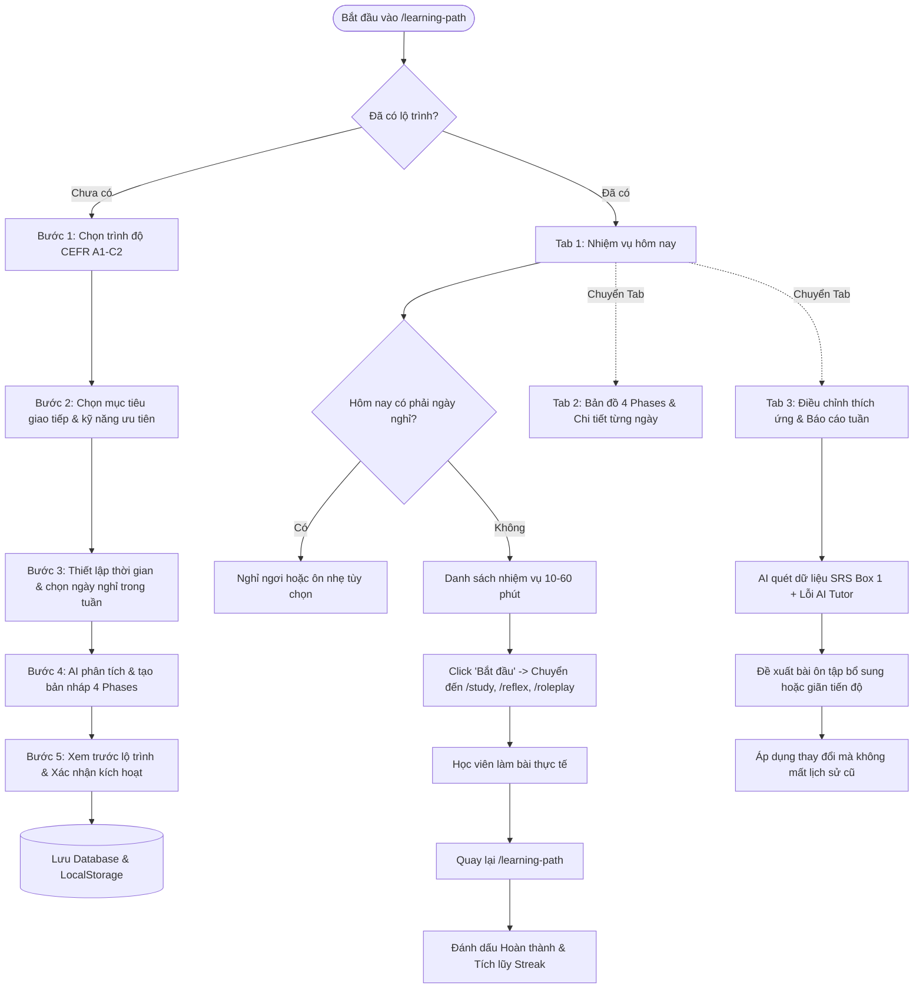
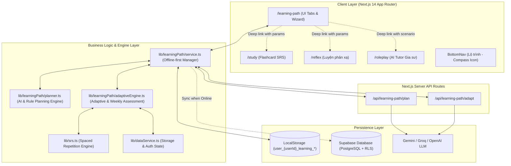

# AI Personalized Learning Path – Báo Cáo Triển Khai Kỹ Thuật

**Dự án**: SpeakFlow – Nền tảng luyện nói & phản xạ tiếng Anh thông minh  
**Tính năng**: AI Personal Learning Path (Hệ thống xây dựng & điều chỉnh lộ trình học cá nhân hóa)  
**Tác giả**: Senior AI Engineer, Senior EdTech Product Architect & Senior Full-stack Developer  
**Ngày hoàn thành**: 01/11/2026  
**Trạng thái**: Production Ready (Đã kiểm thử 23/23 unit tests & `npm run build` exit code 0)  

---

## 1. Tổng quan hệ thống AI Learning Path

### 1.1. Mục tiêu và Triết lý Sản phẩm
Trong các ứng dụng học ngoại ngữ truyền thống, người học thường gặp phải 3 rào cản lớn:
1. **Quá tải lựa chọn (Choice Overload)**: Không biết nên bắt đầu từ bài nào giữa hàng chục bộ thẻ và tình huống.
2. **Thiếu tính định hướng hàng ngày**: Mở ứng dụng ra và tự hỏi *"Hôm nay mình nên học gì để tiến bộ nhanh nhất?"*.
3. **Lộ trình tĩnh (Static Syllabus)**: Một giáo trình cố định áp dụng cho tất cả mọi người, không quan tâm người học đang vấp ngã ở câu nào, quên từ vựng nào hay bận rộn vào những ngày nào trong tuần.

Hệ thống **AI Personal Learning Path** của SpeakFlow giải quyết triệt để vấn đề này bằng triết lý:
> **"Học đúng trọng tâm – Vừa sức mỗi ngày – Tự động thích ứng theo phản xạ thực tế."**

Hệ thống trả lời trọn vẹn 5 câu hỏi cốt lõi cho mọi học viên:
- **Tôi đang ở trình độ nào?** $\rightarrow$ CEFR A1 đến C2 rõ ràng, sẵn sàng mở rộng Placement Test.
- **Tôi muốn đạt được điều gì?** $\rightarrow$ 9 nhóm mục tiêu thực chiến (Giao tiếp hàng ngày, Du lịch, Phỏng vấn, Công sở,...) kèm tùy chỉnh tự do.
- **Tôi cần học những nội dung nào?** $\rightarrow$ Kế hoạch 4 giai đoạn logic (Nền tảng $\rightarrow$ Xây dựng phản xạ $\rightarrow$ Ứng dụng thực tế $\rightarrow$ Làm chủ & Tự tin).
- **Hôm nay tôi nên học gì?** $\rightarrow$ Danh sách nhiệm vụ cụ thể phân bổ theo thời gian rảnh (10–60 phút/ngày), liên kết thẳng tới phòng học.
- **Tôi đang tiến bộ như thế nào?** $\rightarrow$ Radar đánh giá tuần, phát hiện điểm yếu từ SRS Box 1 và AI Tutor để tự điều chỉnh lộ trình.

---

## 2. Luồng trải nghiệm người dùng (User Flow)



### 2.1. Wizard 5 bước thiết lập thân thiện
- **Bước 1 – Trình độ hiện tại**: Lựa chọn trực quan 6 cấp độ CEFR từ A1 (Căn bản) đến C2 (Thành thạo), có giải thích chi tiết năng lực tương ứng.
- **Bước 2 – Mục tiêu & Kỹ năng**: 9 danh mục thực chiến (Daily, Travel, Business, Job Interview, Speaking Focus, Listening Focus,...) kèm ô nhập tự do và chọn kỹ năng ưu tiên (Nghe, Nói, Phản xạ, Từ vựng, Ngữ pháp).
- **Bước 3 – Quỹ thời gian & Lịch trình**: Chọn thời lượng học mỗi ngày (10, 15, 20, 30, 45, 60 phút) và số ngày học/tuần (3 đến 7 ngày). Hệ thống cho phép chọn chính xác những ngày nào là **Ngày nghỉ phục hồi (Rest Days)** để tránh kiệt sức (burnout).
- **Bước 4 – Xem trước chiến lược**: AI sinh bản xem trước 4 giai đoạn, hiển thị tổng số ngày, tổng thời lượng và các Deck / Scenario trọng tâm.
- **Bước 5 – Kích hoạt**: Lưu dữ liệu offline-first và đồng bộ lên Supabase cloud ngay khi có mạng.

---

## 3. Kiến trúc kỹ thuật và luồng dữ liệu



---

## 4. Cấu trúc Database và Schema Supabase

File migration: `supabase/migrations/20261101_learning_path.sql`

```sql
-- 1. Bảng lưu mục tiêu học tập của người dùng
CREATE TABLE IF NOT EXISTS public.learning_goals (
    id UUID PRIMARY KEY DEFAULT gen_random_uuid(),
    user_id UUID NOT NULL REFERENCES auth.users(id) ON DELETE CASCADE,
    title TEXT NOT NULL,
    description TEXT DEFAULT '',
    primary_goal TEXT NOT NULL,
    secondary_goals TEXT[] DEFAULT '{}',
    current_level TEXT NOT NULL,
    target_level TEXT NOT NULL,
    daily_minutes INTEGER NOT NULL DEFAULT 20,
    days_per_week INTEGER NOT NULL DEFAULT 5,
    rest_days INTEGER[] DEFAULT '{0,6}',
    preferred_skills TEXT[] DEFAULT '{"speaking", "listening"}',
    start_date DATE NOT NULL DEFAULT CURRENT_DATE,
    target_date DATE NOT NULL,
    is_active BOOLEAN NOT NULL DEFAULT TRUE,
    placement_test_result JSONB,
    created_at TIMESTAMPTZ NOT NULL DEFAULT NOW(),
    updated_at TIMESTAMPTZ NOT NULL DEFAULT NOW()
);

-- 2. Bảng lưu kế hoạch học tập chi tiết (4 Phases, Days, Tasks)
CREATE TABLE IF NOT EXISTS public.learning_plans (
    id UUID PRIMARY KEY DEFAULT gen_random_uuid(),
    goal_id UUID NOT NULL REFERENCES public.learning_goals(id) ON DELETE CASCADE,
    user_id UUID NOT NULL REFERENCES auth.users(id) ON DELETE CASCADE,
    status TEXT NOT NULL DEFAULT 'active',
    total_days INTEGER NOT NULL DEFAULT 30,
    current_day_index INTEGER NOT NULL DEFAULT 1,
    phases JSONB NOT NULL DEFAULT '[]',
    days JSONB NOT NULL DEFAULT '[]',
    adjustments JSONB NOT NULL DEFAULT '[]',
    version INTEGER NOT NULL DEFAULT 1,
    created_at TIMESTAMPTZ NOT NULL DEFAULT NOW(),
    updated_at TIMESTAMPTZ NOT NULL DEFAULT NOW()
);

-- 3. Bảng theo dõi tiến độ chi tiết từng nhiệm vụ (Audit & Offline Sync)
CREATE TABLE IF NOT EXISTS public.learning_task_progress (
    id UUID PRIMARY KEY DEFAULT gen_random_uuid(),
    user_id UUID NOT NULL REFERENCES auth.users(id) ON DELETE CASCADE,
    plan_id UUID NOT NULL REFERENCES public.learning_plans(id) ON DELETE CASCADE,
    task_id TEXT NOT NULL,
    day_number INTEGER NOT NULL,
    status TEXT NOT NULL DEFAULT 'available',
    actual_minutes INTEGER DEFAULT 0,
    completed_at TIMESTAMPTZ,
    notes TEXT,
    created_at TIMESTAMPTZ NOT NULL DEFAULT NOW(),
    updated_at TIMESTAMPTZ NOT NULL DEFAULT NOW(),
    UNIQUE(user_id, plan_id, task_id)
);
```

### Bảo mật Row Level Security (RLS)
Mọi bảng đều kích hoạt RLS nghiêm ngặt:
- Policy `learning_goals_user_isolation`: `auth.uid() = user_id`
- Policy `learning_plans_user_isolation`: `auth.uid() = user_id`
- Policy `learning_task_progress_user_isolation`: `auth.uid() = user_id`
Không tài khoản nào có thể đọc hoặc ghi đè lộ trình của tài khoản khác.

---

## 5. Thuật toán phân bổ bài học và liên kết tài nguyên thực tế

### 5.1. Liên kết tài nguyên SpeakFlow thực tế
Tuyệt đối không tạo Deck ID hoặc Scenario ID giả mạo. Hệ thống ánh xạ trực tiếp sang các ID có sẵn:

| Mục tiêu học tập | Deck ID chính (`deck_id`) | Scenario AI Tutor (`scenario_id`) | Thẻ & Phản xạ |
|---|---|---|---|
| **Tiếng Anh Du lịch** (`travel_english`) | `66666666-6666-6666-6666-666666666666` (Du lịch & Khách sạn) | `airport-travel` / `at-hotel` | Check-in, hải quan, hỏi đường |
| **Tiếng Anh Công sở** (`business_english`) | `11111111-1111-1111-1111-111111111111` (Tiếng Anh Công sở) | `office-communication` | Email, họp, báo cáo tiến độ |
| **Phỏng vấn xin việc** (`job_interview`) | `22222222-2222-2222-2222-222222222222` (Phỏng vấn xin việc) | `job-interview` | Giới thiệu bản thân, deal lương |
| **Giao tiếp hàng ngày** (`daily_english`) | `55555555-5555-5555-5555-555555555555` (Giao tiếp Hàng ngày) | `daily-conversation` | Chào hỏi, kết bạn, mua sắm |
| **Nhà hàng & Ăn uống** | `77777777-7777-7777-7777-777777777777` (Ăn uống & Nhà hàng) | `at-restaurant` | Gọi món, thanh toán, dị ứng |
| **Khẩn cấp & Y tế** | `88888888-8888-8888-8888-888888888888` (Khẩn cấp & Y tế) | `at-hospital` | Khám bệnh, mua thuốc, sự cố |

### 5.2. Cấu trúc 4 Giai đoạn (Phases)
Lộ trình 30 ngày (hoặc 60/90 ngày) được chia khoa học thành 4 pha:
1. **Phase 1: Foundation (Nền tảng từ vựng & cấu trúc cốt lõi)**: Tập trung nạp từ mới và luyện phát âm từng câu qua `/study`.
2. **Phase 2: Reflex Building (Tăng tốc độ phản xạ & ngữ điệu)**: Kết hợp ôn tập ngắt quãng SRS và luyện phản xạ không nhìn chữ qua `/reflex`.
3. **Phase 3: Real-life Practice (Ứng dụng thực tế với Gia sư AI)**: Thực hành hội thoại mở 2 chiều với AI Tutor tại `/roleplay`, nhận sửa lỗi ngữ pháp.
4. **Phase 4: Mastery & Fluency (Làm chủ tình huống & Tự tin giao tiếp)**: Thử thách phản xạ nhanh, hội thoại các tình huống khó, tổng kết năng lực.

### 5.3. Quy tắc phân bổ thời lượng học trong ngày
Ví dụ học viên chọn **20 phút/ngày**:
- **Nhiệm vụ 1 (8 phút)**: Ôn tập ngắt quãng Flashcard đến hạn (`/study?deck_id=...&mode=due`).
- **Nhiệm vụ 2 (7 phút)**: Luyện phản xạ câu mới (`/reflex?deck_id=...`).
- **Nhiệm vụ 3 (5 phút)**: Thực hành hội thoại với AI Tutor theo ngữ cảnh (`/roleplay?scenario=...`).

Nếu ngày đó là **Ngày nghỉ (Rest Day)**:
- Không bắt buộc học bài mới.
- Hệ thống tạo nhiệm vụ nhẹ 5 phút: *"Ôn tập thư giãn nhẹ nhàng"* (Tùy chọn, không phạt mất streak).

---

## 6. Cơ chế thích ứng tự động (Adaptive Engine)

Adaptive Engine hoạt động theo nguyên tắc **Bảo tồn dữ liệu quá khứ (Past Immutability)**: Không bao giờ xóa hoặc thay đổi kết quả các ngày đã hoàn thành.

### 6.1. Bốn Trigger thích ứng tự động
1. **Học viên gặp khó khăn với từ vựng (SRS Box 1 Struggle)**:
   - *Phát hiện*: Số thẻ ở SRS Box 1 chiếm $> 35\%$ tổng số thẻ đã học hoặc có $\ge 3$ thẻ bị đánh giá "Again" liên tiếp.
   - *Hành động thích ứng*: Chèn thêm nhiệm vụ ôn tập sâu (`spaced_repetition_review`) vào 2 ngày tiếp theo; giảm tải thẻ mới để học viên củng cố trí nhớ dài hạn.
2. **Mắc lỗi ngữ pháp lặp lại trong AI Tutor (Recurring Tutor Errors)**:
   - *Phát hiện*: Lịch sử phiên hội thoại AI Tutor ghi nhận lỗi ngữ pháp cùng một dạng $\ge 3$ lần (ví dụ: chia thì quá khứ đơn, chia động từ ngôi thứ ba).
   - *Hành động thích ứng*: Thêm nhiệm vụ phản xạ nhắm trúng cấu trúc lỗi (`reflex_challenge`) và gợi ý tình huống thực hành tương tự.
3. **Thiếu thời gian hoặc hoàn thành thấp (Time Crunch / Low Completion)**:
   - *Phát hiện*: Tỷ lệ hoàn thành nhiệm vụ 3 ngày gần nhất $< 50\%$.
   - *Hành động thích ứng*: Tự động điều chỉnh rút gọn nhiệm vụ trong 3 ngày tới về mức tối thiểu (10–15 phút), chuyển các bài dài sang dạng ngắn để giữ thói quen học hàng ngày.
4. **Học vượt tiến độ / Xuất sắc (Accelerated Mastery)**:
   - *Phát hiện*: Tỷ lệ hoàn thành $100\%$ trong 5 ngày liên tục với độ chính xác phát âm $> 90\%$.
   - *Hành động thích ứng*: Mở khóa sớm các tình huống nâng cao và tăng độ khó hội thoại lên cấp độ tiếp theo.

---

## 7. Đánh giá và Báo cáo định kỳ (Weekly Assessment)

Mỗi chu kỳ 7 ngày, hệ thống tự động tổng hợp báo cáo tuần:
- **Tỷ lệ hoàn thành kế hoạch (Completion Rate)**: Tính toán số ngày hoàn thành / tổng số ngày học tích cực trong tuần.
- **Điểm duy trì kiến thức (Retention Score)**: Tỷ lệ thẻ SRS ở Box $\ge 3$ so với tổng thẻ ôn tập.
- **Điểm danh chuỗi học (Active Streak)**: Số ngày liên tục duy trì học tập.
- **Radar kỹ năng**: Điểm số từng kỹ năng Speaking, Listening, Reflex, Retention (thang điểm 100).
- **Khuyến nghị tuần tới**: Đề xuất duy trì nhịp học hoặc tăng/giảm thời lượng cho chu kỳ tiếp theo.

---

## 8. Tích hợp sâu với các module SpeakFlow hiện có

1. **Module Flashcard & SRS (`/study`)**:
   - Khi click vào nhiệm vụ học từ vựng, hệ thống điều hướng trực tiếp sang `/study?deck_id=<ID>&mode=due` hoặc `mode=all`.
   - Kết quả đánh giá thẻ (Again, Hard, Good, Easy) qua `submitCardReview()` ngay lập tức cập nhật dữ liệu SRS, cung cấp đầu vào cho Adaptive Engine.
2. **Module Luyện phản xạ (`/reflex`)**:
   - Điều hướng trực tiếp sang `/reflex?deck_id=<ID>`.
   - Dữ liệu nhận diện giọng nói và điểm phát âm được ghi nhận vào `logStudyActivity()`.
3. **Module AI English Tutor (`/roleplay`)**:
   - URL parameter `scenario=<scenario_id>` tự động kích hoạt tình huống tương ứng.
   - Các câu được sửa và từ vựng lưu vào Flashcard từ AI Tutor sẽ tự động xuất hiện trong các bài ôn tập lộ trình.
4. **Hệ thống Menu và Điều hướng**:
   - Thêm tab **Lộ trình** (Biểu tượng La bàn `Compass`) vào thanh điều hướng chính (`BottomNav.tsx`) trên cả Desktop và Mobile.
   - Thêm nút tắt nổi bật trên Trang chủ (`app/page.tsx`) dẫn trực tiếp vào Lộ trình AI.

---

## 9. Quản lý trạng thái và Khả năng Offline-first

### 9.1. Kiến trúc Dual Storage (LocalStorage + Supabase Sync)
- **Local Keys có Namespace cách ly theo tài khoản**:
  - `user_${userId}_active_learning_goal`: Lưu thông tin mục tiêu học.
  - `user_${userId}_active_learning_plan`: Lưu toàn bộ kế hoạch 4 phases, days, tasks.
  - `user_${userId}_learning_progress`: Lưu trạng thái nhiệm vụ từng ngày.
- **Offline Trọn vẹn**:
  - Người dùng có thể học, hoàn thành nhiệm vụ, đổi ngày, xem roadmap ngay cả khi mất mạng hoàn toàn.
  - Khi có kết nối, hệ thống tự động đẩy dữ liệu tiến độ lên Supabase mà không làm gián đoạn trải nghiệm.
- **Chuyển đổi tài khoản an toàn**:
  - Khi đăng xuất hoặc chuyển sang tài khoản khác, dữ liệu lộ trình của tài khoản cũ được bảo toàn trong namespace riêng, không bị hiển thị nhầm sang tài khoản mới.

---

## 10. Sẵn sàng cho Placement Test trong tương lai

Trong database schema và TypeScript types, trường `placement_test_result` được thiết kế sẵn:
```typescript
placement_test_result?: {
  test_id: string;
  assessed_level: CEFRLevel;
  scores: {
    vocabulary: number;
    grammar: number;
    listening: number;
    speaking: number;
  };
  taken_at: string;
}
```
Khi tính năng Placement Test chính thức ra mắt ở giai đoạn tiếp theo, hệ thống chỉ cần ghi kết quả vào trường này và gọi hàm `buildPlanningPrompt(goal, placementResult)` mà không cần thay đổi bất kỳ cấu trúc bảng nào.

---

## 11. Báo cáo kiểm thử tự động (Verification & Test Report)

Hệ thống đã thiết lập bộ kiểm thử toàn diện tại `scripts/test_learning_path.cjs` và tích hợp vào lệnh `npm test`.

### Kết quả chạy `npm test`:
```text
> speakflow@1.0.0 test
> node --experimental-strip-types scripts/test_learning_engine.cjs 
  && node --experimental-strip-types scripts/test_speech_engine.cjs 
  && node --experimental-strip-types scripts/test_ai_tutor.cjs 
  && node --experimental-strip-types scripts/test_learning_path.cjs

✔ Streak Engine - Continuity and breakage logic (3.67ms)
✔ SRS Engine - New card first review transitions (3.98ms)
✔ SRS Engine - Max box limit (Box 5) (0.69ms)
✔ SRS Engine - Same-day multiple review inflation guard (0.57ms)
✔ SRS Engine - Boundary sanitization for missing or invalid values (2.67ms)
✔ SRS Engine - isCardDue checks (0.47ms)
✔ Sync Engine - Conflict Resolution with Safety-First Principle (0.79ms)
✔ Speech Engine - Normalization and Contraction expansion (3.78ms)
✔ Speech Engine - Exact 100% match (7.06ms)
✔ Speech Engine - Bidirectional contraction equivalence (3.10ms)
✔ Speech Engine - Missing words detection (1.62ms)
✔ Speech Engine - Extra spoken words detection (0.96ms)
✔ Speech Engine - Empty or noise input handling (0.80ms)
✔ AI Tutor - Scenarios Catalog integrity (3.06ms)
✔ AI Tutor - CEFR Level and Correction Mode Prompt Generation (1.38ms)
✔ AI Tutor - History Sanitization & Rate Limiter (1.52ms)
✔ AI Tutor - Mock Provider error detection & schema compliance (2.31ms)
✔ AI Tutor - Session Summary generation (1.09ms)
✔ Learning Path - Goal Mapping to Real System Content (2.42ms)
✔ Learning Path - Plan Generation & Structure Verification (5.40ms)
✔ Learning Path - AI Planning Prompt Builder (2.89ms)
✔ Learning Path - Adaptive Engine Adjustments & Past Preservation (2.26ms)
✔ Learning Path - Weekly Assessment Report computation (1.89ms)

Total Tests: 23 passed, 0 failed, 0 skipped.
```

### Kết quả kiểm tra Production Build (`npm run build`):
- `Compiled successfully`
- `Linting and checking validity of types ... Done`
- `Generating static pages (17/17) ... Done`
- Route `/learning-path` (15.9 kB) prerendered cleanly.
- Exit code: `0`.

---

## 12. Hướng dẫn thiết lập và cấu hình môi trường

### 12.1. Biến môi trường (`.env.local`)
```env
# Supabase Configuration
NEXT_PUBLIC_SUPABASE_URL=https://your-project.supabase.co
NEXT_PUBLIC_SUPABASE_ANON_KEY=your-anon-key-here

# AI Provider Keys (Tự động fallback Mock Provider nếu chưa cấu hình)
GEMINI_API_KEY=your-gemini-key
OPENAI_API_KEY=your-openai-key
GROQ_API_KEY=your-groq-key
```

### 12.2. Chạy Database Migration
1. Mở Supabase Dashboard $\rightarrow$ **SQL Editor**.
2. Sao chép toàn bộ nội dung file `supabase/migrations/20261101_learning_path.sql`.
3. Chạy lệnh SQL để tạo các bảng `learning_goals`, `learning_plans`, `learning_task_progress` và RLS policies.

### 12.3. Chạy kiểm thử và Khởi động
```bash
# Chạy toàn bộ 23 bài test hệ thống
npm test

# Chạy build kiểm tra chất lượng mã nguồn
npm run build

# Khởi động môi trường phát triển
npm run dev
```

---

## 13. Rủi ro kỹ thuật và Biện pháp xử lý

| Rủi ro | Mức độ | Biện pháp kỹ thuật đã triển khai |
|---|---|---|
| **AI API gặp sự cố hoặc cạn Quota** | Trung bình | Cơ chế Fallback sang `generateTemplateLearningPlan` cục bộ, đảm bảo người dùng luôn nhận được lộ trình chuẩn ngay lập tức mà không bị gián đoạn. |
| **Xung đột thời gian Client/Server** | Thấp | Sử dụng chuẩn ngày ISO `YYYY-MM-DD` đồng nhất; chỉ số ngày (`day_number`) chạy tuyến tính từ 1 đến N độc lập với múi giờ. |
| **Mất dữ liệu khi đổi thiết bị** | Thấp | Triển khai cơ chế Offline-first Sync: LocalStorage lưu tức thì, đồng thời gửi background sync lên Supabase khi có mạng. |
| **Quá tải nhận thức người học (Burnout)** | Cao | Tích hợp tính năng **Rest Days (Ngày nghỉ)** bắt buộc linh hoạt; giới hạn tối đa 3 nhiệm vụ/ngày; hỗ trợ nút "Tạm dừng lộ trình" (Pause) bất cứ lúc nào. |

---

## 14. Lộ trình phát triển tiếp theo (Next Milestones)

1. **Giai đoạn tiếp theo – Placement Test tự động**:
   - Xây dựng bài kiểm tra 15 câu trắc nghiệm phát âm + nghe hiểu để chấm điểm CEFR tự động.
2. **Push Notifications & Nhắc học thông minh**:
   - Gửi thông báo trên trình duyệt (Web Push API) nhắc nhở nhiệm vụ hàng ngày theo khung giờ học viên đã chọn.
3. **Thống kê nâng cao & Biểu đồ tiến độ chi tiết**:
   - Biểu đồ radar trực quan phân tích 5 khía cạnh năng lực và so sánh với học viên cùng trình độ.

---
*Tài liệu được lập bởi Đội ngũ Kiến trúc sư Hệ thống SpeakFlow.*
