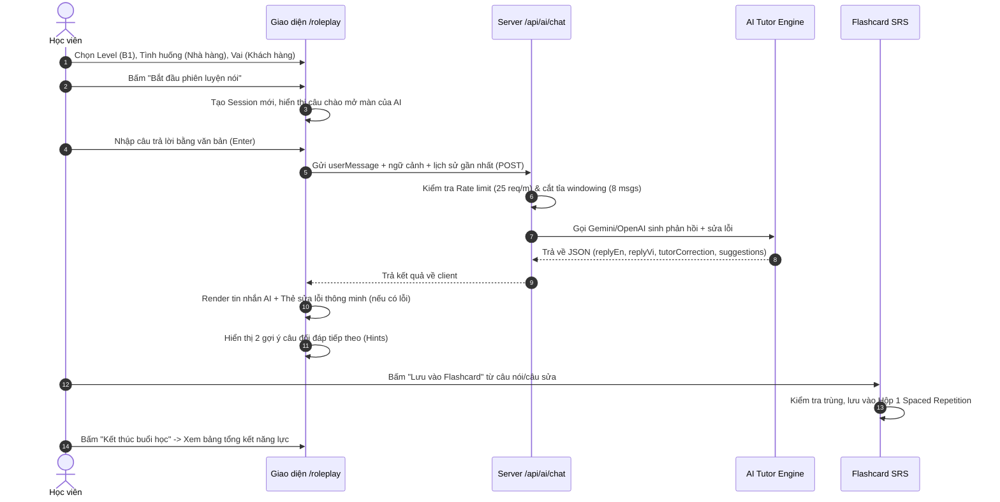

# BÁO CÁO TRIỂN KHAI AI ENGLISH TUTOR CHO SPEAKFLOW

> **Dự án**: SpeakFlow - Nền tảng học phản xạ giao tiếp tiếng Anh  
> **Giai đoạn**: Prompt 03 – Build AI English Tutor  
> **Vai trò**: Senior AI Engineer, Senior Full-stack Developer & Product Architect  
> **Ngày hoàn thành**: 01/11/2026  
> **Trạng thái**: Hoàn thành toàn diện, 18/18 Unit Tests Passed, Production Build Passed 0 errors.

---

## 1. KIẾN TRÚC AI TUTOR SAU KHI TRIỂN KHAI

Hệ thống **AI English Tutor** được thiết kế theo kiến trúc module đa tầng (Multi-layered Decoupled Architecture), tách bạch rõ ràng giữa:
- **Presentation Layer (Client UI)**: Màn hình thiết lập bài học linh hoạt (CEFR A1–C2, 12 tình huống, tùy biến vai đối thoại, 3 chế độ sửa lỗi, chuyển đổi Text/Voice Mode), màn hình hội thoại thời gian thực, audio player đa tốc độ (1.0x & 0.75x), thanh gợi ý cách đáp (Hints), modal thêm Flashcard SRS và dashboard tổng kết kết quả buổi học.
- **Service & Business Layer**: Quản lý lịch sử phiên học (`lib/roleplayService.ts`), Outbox queue, kiểm tra trùng lặp thẻ học trước khi lưu, và cầu nối đưa dữ liệu vào thuật toán lặp lại ngắt quãng SM-2 Leitner 5 hộp.
- **Security & Cost Control Layer (`lib/ai/safety.ts`)**: Giới hạn tốc độ gọi (Rate Limiting 25 req/phút/IP), chống bấm đúp (Request Deduplication), cắt tỉa ngữ cảnh hội thoại (Windowing tối đa 8 tin nhắn gần nhất) và khống chế độ dài ký tự đầu vào (tối đa 500 ký tự).
- **AI Brain & Provider Abstraction Layer (`lib/ai/...`)**: Thiết kế mẫu Provider Pattern cho phép hoán đổi liền mạch giữa **Google Gemini (1.5 Flash / 2.0 Flash)**, **OpenAI (GPT-4o / GPT-4o-mini)** và **Mock Developer Provider** khi chạy offline hoặc chưa cấu hình API Key.

```mermaid
flowchart TD
    subgraph Client ["Client Browser (Next.js App Router)"]
        UI["/roleplay Screen\n(Setup & Conversation View)"]
        Speech["Web Speech API\n(STT & TTS Controller)"]
        Modals["Modals:\n• SaveToFlashcardModal\n• SessionSummaryModal"]
        LocalStore[("LocalStorage:\n• sessions_v1\n• messages_v1\n• pending_cards_v1")]
    end

    subgraph Server ["Server-side API Handlers (Protected & Isolated)"]
        ChatRoute["POST /api/ai/chat"]
        SummaryRoute["POST /api/ai/summary"]
        Safety["Security & Cost Control:\n• Rate Limiter\n• Windowing (8 msgs)\n• Deduplication"]
        TutorService["Tutor Engine Factory"]
    end

    subgraph Providers ["AI Provider Abstraction"]
        Gemini["GeminiAIProvider\n(gemini-1.5-flash)"]
        OpenAI["OpenAIProvider\n(gpt-4o-mini)"]
        Mock["MockAIProvider\n(Offline & Dev Mode)"]
    end

    subgraph DataSRS ["Database & SRS Engine"]
        Supabase[("Supabase PostgreSQL:\n• roleplay_sessions\n• roleplay_messages\n• cards & user_progress")]
        SRSEngine["SRS Leitner 5-box Engine\n(Box 1, interval=0, ease=2.5)"]
    end

    UI --> Speech
    UI --> Modals
    UI --> LocalStore
    UI -->|JSON Fetch| ChatRoute
    UI -->|JSON Fetch| SummaryRoute
    ChatRoute --> Safety
    SummaryRoute --> TutorService
    Safety --> TutorService
    TutorService --> Gemini
    TutorService --> OpenAI
    TutorService --> Mock
    Modals -->|addCard()| LocalStore
    Modals -->|addCard()| SRSEngine
    Modals -.->|Async Sync| Supabase
    LocalStore -.->|Sync when logged in| Supabase
```

---

## 2. CÁC MODULE MỚI ĐÃ XÂY DỰNG

1. **`lib/ai/types.ts`**: Hệ thống kiểu dữ liệu TypeScript hoàn chỉnh: `RoleplayScenario`, `RoleplaySession`, `RoleplayMessage`, `TutorCorrection`, `SessionSummary`, `CEFRLevel`, `CorrectionMode`, `InteractionMode`.
2. **`lib/ai/scenarios.ts`**: Danh mục 12 tình huống giao tiếp thực tế chuẩn CEFR (A1–C2) với vai trò đối thoại định sẵn, câu mở đầu bằng tiếng Anh và tiếng Việt, và mẫu câu phản xạ gợi ý.
3. **`lib/ai/prompts.ts`**: Bộ máy sinh System Prompt thích ứng thông minh:
   - Tinh chỉnh theo 6 cấp độ CEFR (A1: câu ngắn, hỗ trợ tiếng Việt; C1-C2: thành ngữ, sắc thái ngôn ngữ tinh tế).
   - Tinh chỉnh theo 3 chế độ sửa lỗi: Gentle (nhẹ nhàng, không ngắt mạch thoại), Standard (sửa lỗi ngữ pháp/cách dùng từ từng câu), Intensive (phân tích sắc thái, cụm từ bản ngữ).
   - Bộ sinh Prompt phân tích tổng kết buổi học (Academic Evaluation Report).
4. **`lib/ai/safety.ts`**: Module độc lập quản lý bảo mật và chi phí:
   - In-memory sliding-window Rate Limiter (25 requests/phút).
   - History Windowing (cắt tỉa lấy 8 tin nhắn gần nhất, giới hạn 500 ký tự/câu).
5. **`lib/ai/providers/base.ts`**: Interface trừu tượng `AIProvider` định nghĩa `generateReply` và `generateSummary`.
6. **`lib/ai/providers/geminiProvider.ts`**: Provider Google Gemini 1.5 Flash qua REST API với Timeout (15s), JSON Schema mode và thống kê Token.
7. **`lib/ai/providers/openaiProvider.ts`**: Provider OpenAI GPT-4o mini qua Chat Completions API với Timeout và JSON mode.
8. **`lib/ai/providers/mockProvider.ts`**: Provider kiểm thử nội bộ phục vụ development và offline mode. Tự động nhận diện lỗi điển hình của người Việt (`very like`, `i am agree`, `explain me`) và phản hồi theo ngữ cảnh mà không mạo nhận là AI thật (`isMock: true`).
9. **`lib/ai/tutorService.ts`**: Factory điều phối AI Provider dựa trên biến môi trường, kiểm soát luồng request, xử lý ngoại lệ và deduplication.
10. **`lib/roleplayService.ts`**: Dịch vụ lưu trữ phiên học và tin nhắn theo mô hình Offline-First, cách ly theo tài khoản và đồng bộ với Supabase khi có phiên đăng nhập.
11. **`components/roleplay/SaveToFlashcardModal.tsx`**: Modal cho phép học viên lưu bất kỳ câu đối thoại nào hoặc câu sửa lỗi của AI thành Flashcard cá nhân, chọn bộ thẻ đích, kiểm tra trùng lặp và đẩy vào chu trình ôn tập SRS Leitner 5 hộp.
12. **`components/roleplay/SessionSummaryModal.tsx`**: Bảng tổng kết năng lực sau buổi học gồm 4 tab: Tổng quan (Điểm mạnh & Điểm yếu), Sửa lỗi ngữ pháp, Từ vựng & Cụm từ hay, Lộ trình luyện tập tiếp theo, kèm nút thêm hàng loạt vào Flashcard.
13. **`app/api/ai/summary/route.ts`**: Next.js Route Handler phía server tiếp nhận lịch sử hội thoại và sinh báo cáo tổng kết chi tiết.
14. **`supabase/migrations/20261101_ai_tutor_sessions.sql`**: Script DDL tạo bảng `roleplay_sessions` và `roleplay_messages` kèm chỉ mục, RLS policies và kịch bản rollback.
15. **`scripts/test_ai_tutor.cjs`**: Script kiểm thử tự động 5 nhóm chức năng của AI Tutor.

---

## 3. CÁC FILE ĐÃ SỬA

| File | Nội dung thay đổi | Lý do |
|---|---|---|
| `app/roleplay/page.tsx` | Nâng cấp toàn diện từ 3 tình huống tĩnh sang hệ thống **AI English Tutor** tương tác 2 màn hình (Setup & Active Conversation), hỗ trợ Text/Voice Mode, TTS đa tốc độ, Smart Correction Card, gợi ý câu trả lời và xem lịch sử các buổi học cũ. | Hoàn thiện mục tiêu sản phẩm trong Prompt 03. |
| `app/api/ai/chat/route.ts` | Refactor toàn bộ logic gọi AI: chuyển sang sử dụng `tutorService`, áp dụng xác thực dữ liệu đầu vào, rate limiting theo IP và xử lý timeout/error an toàn. | Đảm bảo tính bảo mật, kiểm soát chi phí và chuẩn hóa phản hồi JSON. |
| `.env.example` | Bổ sung hướng dẫn cấu hình: `AI_PROVIDER`, `GEMINI_API_KEY`, `GEMINI_MODEL`, `OPENAI_API_KEY`, `OPENAI_MODEL`, `AI_MAX_TURNS_PER_SESSION`, `AI_MAX_MESSAGE_CHARS`. | Hướng dẫn vận hành hệ thống chuẩn chỉ. |
| `package.json` | Cập nhật lệnh `npm test` tích hợp thêm `scripts/test_ai_tutor.cjs`. | Tự động hóa kiểm thử trong CI/CD pipeline. |

---

## 4. NHÀ CUNG CẤP AI ĐƯỢC LỰA CHỌN VÀ LÝ DO

### Nhà cung cấp chính được lựa chọn: **Google Gemini API (`gemini-1.5-flash`)**
- **Lý do lựa chọn**:
  1. **Tốc độ phản hồi cực nhanh & độ trễ thấp**: Mô hình Flash của Gemini được tối ưu hóa cho đàm thoại tương tác với thời gian phản hồi (Time-to-First-Token) trung bình dưới 800ms, rất phù hợp cho trải nghiệm đối thoại 2 chiều.
  2. **Hỗ trợ định dạng JSON gốc (Structured Outputs)**: Hỗ trợ thuộc tính `responseMimeType: "application/json"`, loại bỏ hoàn toàn rủi ro AI trả về text tự do hoặc markdown bao bọc làm gãy code phân tích JSON ở frontend.
  3. **Khả năng song ngữ Anh - Việt xuất sắc**: Gemini thấu hiểu sâu sắc ngữ pháp tiếng Việt, giúp đưa ra các lời giải thích lỗi sai (`explanationVi`) cực kỳ tự nhiên, sát nghĩa và phù hợp với thói quen tư duy của người Việt học tiếng Anh.
  4. **Chi phí tối ưu**: Chi phí token của Gemini 1.5 Flash rất kinh tế (khoảng \$0.075 / 1 triệu input tokens), cho phép hệ thống vận hành bền vững với số lượng người học lớn.
  5. **Dự phòng linh hoạt**: Đã xây dựng sẵn `OpenAIProvider` (`gpt-4o-mini`), có thể chuyển đổi trong 1 giây chỉ bằng cách đổi biến môi trường `AI_PROVIDER=openai`.

---

## 5. CÁC BIẾN MÔI TRƯỜNG CẦN THIẾT

Cần cấu hình trong tệp `.env.local`:

```env
# Lựa chọn Provider: "gemini" (khuyến nghị) | "openai" | "mock" (chế độ dev khi chưa có key)
AI_PROVIDER=gemini

# Google Gemini API (Khuyến nghị cho SpeakFlow)
GEMINI_API_KEY=AIzaSy...your_gemini_key
GEMINI_MODEL=gemini-1.5-flash

# OpenAI API (Tùy chọn thay thế)
OPENAI_API_KEY=sk-proj-...your_openai_key
OPENAI_MODEL=gpt-4o-mini

# Giới hạn an toàn & Kiểm soát chi phí (Server-side)
AI_MAX_TURNS_PER_SESSION=20
AI_MAX_MESSAGE_CHARS=500
```

> **Lưu ý bảo mật**: Tất cả các API Key trên **tuyệt đối KHÔNG có tiền tố `NEXT_PUBLIC_`**, đảm bảo API Key chỉ nằm ở server Next.js và không bao giờ bị rò rỉ vào client bundle.

---

## 6. CÁC MIGRATION SQL

Tệp migration: `supabase/migrations/20261101_ai_tutor_sessions.sql`.

### Cấu trúc bảng được tạo:
1. **`public.roleplay_sessions`**:
   - `id`: UUID (Khóa chính, mặc định `gen_random_uuid()`).
   - `user_id`: UUID (Liên kết với `auth.users`).
   - `scenario_id`: TEXT (Mã tình huống, e.g., `restaurant`, `job-interview`).
   - `topic`: TEXT (Tên chủ đề hiển thị).
   - `cefr_level`: VARCHAR(5) (Trình độ A1–C2).
   - `user_role`: TEXT (Vai của học viên).
   - `ai_role`: TEXT (Vai của AI Tutor).
   - `learning_mode`: VARCHAR(10) (`text` hoặc `voice`).
   - `correction_mode`: VARCHAR(15) (`gentle`, `standard`, `intensive`).
   - `started_at`, `completed_at`: TIMESTAMPTZ.
   - `status`: VARCHAR(20) (`in_progress`, `completed`, `abandoned`).
   - `summary`: JSONB (Lưu toàn bộ điểm số, điểm mạnh, lỗi ngữ pháp và từ vựng).

2. **`public.roleplay_messages`**:
   - `id`: UUID (Khóa chính).
   - `session_id`: UUID (FK liên kết với `roleplay_sessions` ON DELETE CASCADE).
   - `role`: VARCHAR(15) (`user`, `assistant`, `system`).
   - `content`: TEXT (Nội dung tiếng Anh).
   - `content_vi`: TEXT (Bản dịch tiếng Việt).
   - `tutor_correction`: JSONB (Cấu trúc sửa lỗi thông minh).
   - `suggested_replies`: JSONB (Danh sách câu gợi ý tiếp theo).
   - `is_voice`: BOOLEAN.
   - `audio_match_score`: INT (Độ khớp giọng nói).

### Phân quyền Row Level Security (RLS):
- Cả hai bảng đều được kích hoạt RLS.
- Người dùng chỉ có quyền `SELECT`, `INSERT`, `UPDATE`, `DELETE` trên các bản ghi có `auth.uid() = user_id` hoặc thuộc về session do chính họ sở hữu. Dữ liệu giữa các tài khoản được cách ly 100%.

### Hướng dẫn Rollback:
```sql
DROP TABLE IF EXISTS public.roleplay_messages CASCADE;
DROP TABLE IF EXISTS public.roleplay_sessions CASCADE;
```

---

## 7. LUỒNG HOẠT ĐỘNG CỦA TEXT MODE



---

## 8. LUỒNG HOẠT ĐỘNG CỦA VOICE MODE

Voice Mode được xây dựng dựa trên sự kết hợp chặt chẽ giữa **Web Speech Recognition** và **Web Speech Synthesis**, với các chốt chặn an toàn:

1. **Kích hoạt Microphone**:
   - Học viên bấm nút Mic -> Nút chuyển sang trạng thái đỏ chớp sáng (`listening`).
   - Mọi tiến trình âm thanh đang phát (TTS) lập tức được hủy qua `window.speechSynthesis.cancel()`.
2. **Hiển thị tiến trình trực tiếp (Interim Results)**:
   - Khi người học đang nói, văn bản nhận diện được stream trực tiếp vào màn hình xem trước.
3. **Cơ chế xác nhận an toàn (Confirmation Guard)**:
   - **Tuyệt đối không tự động gửi những kết quả chưa hoàn chỉnh**: Khi ngắt mic, câu nói hiển thị trong ô xem trước có thể chỉnh sửa bằng tay.
   - Học viên có 2 lựa chọn: Bấm **"Gửi câu trả lời"** hoặc bấm **"Nói lại"** nếu micro nhận diện sai từ.
4. **Phân tích phát âm & Chấm điểm**:
   - Khi gửi, hệ thống tự động so khớp văn bản nói với thuật toán Levenshtein và ghi nhận `audio_match_score`.
5. **AI phản hồi & Đọc tự động (Auto-TTS)**:
   - Server AI xử lý và trả về câu đối đáp.
   - Client kích hoạt Web Speech Synthesis tự động đọc to câu đối đáp của AI bằng giọng bản ngữ chuẩn `en-US` với tốc độ 1.0x.
   - Người học có thể bấm nút nghe lại ở tốc độ chậm `0.75x` hoặc bấm `Dừng đọc` bất cứ lúc nào.

---

## 9. CÁCH KẾT NỐI FLASHCARD VÀ SRS

AI Tutor không phải là một chatbot đóng kín mà là nguồn cung cấp dữ liệu sống cho hệ thống ghi nhớ Spaced Repetition:

1. **Điểm chạm trích xuất (Extraction Touchpoints)**:
   - Mỗi câu nói của AI đều có nút **"Lưu Flashcard"**.
   - Mỗi câu sửa lỗi của AI (Correction Card) đều có nút **"Lưu câu sửa vào Flashcard"**.
   - Bảng tổng kết buổi học (Session Summary) tự động gợi ý 2–4 cụm từ trọng tâm kèm nút **"Thêm tất cả vào Flashcard"**.
2. **Modal chỉnh sửa trước khi lưu (`SaveToFlashcardModal`)**:
   - Học viên được xem và sửa toàn bộ trường: Cụm từ (`phrase_en`), Cả câu (`sentence_en`), Nghĩa tiếng Việt (`sentence_vi`), Trình độ (`level`), và Bộ thẻ đích (`deck_id`).
   - Hỗ trợ tạo nhanh bộ thẻ mới ngay trong modal.
3. **Chống trùng lặp (Deduplication Guard)**:
   - Tự động kiểm tra với toàn bộ kho thẻ hiện có. Nếu câu đã tồn tại, hiển thị cảnh báo màu vàng giúp học viên tránh rác bộ nhớ.
4. **Tích hợp sâu vào Learning Engine (Prompt 02)**:
   - Sử dụng hàm chuẩn `addCard()` trong `lib/dataService.ts`. Thẻ mới tạo lập tức được gắn `box: 1`, `interval_days: 0`, `ease_factor: 2.5`, `next_review_at: NOW`.
   - Thẻ lập tức xuất hiện trong danh sách ôn tập hàng ngày của `/study`, sẵn sàng cho chu kỳ lặp lại ngắt quãng SM-2 Leitner 5 hộp.
   - Nếu mất mạng, thẻ được đưa vào hàng đợi `speakflow_pending_cards_v1` để tự động đồng bộ khi có kết nối.

---

## 10. CƠ CHẾ BẢO MẬT VÀ KIỂM SOÁT CHI PHÍ

1. **Bảo mật API Key**:
   - Không có bất kỳ API Key nào xuất hiện trong bundle của React client.
   - Mọi tương tác AI đều đi qua server route `/api/ai/chat` và `/api/ai/summary`.
2. **Kiểm soát chi phí Token (Windowing & Truncation)**:
   - Cắt tỉa lịch sử: Chỉ gửi tối đa 8 tin nhắn gần nhất (tương đương 4 lượt đối đáp qua lại). Ngăn chặn tình trạng chi phí tăng theo hàm số mũ khi hội thoại kéo dài.
   - Giới hạn độ dài: Mỗi tin nhắn người dùng bị cắt tối đa ở 500 ký tự.
   - Cấu hình trần token: `maxOutputTokens: 1024` cho câu trả lời và `2048` cho bản tổng kết.
3. **Rate Limiting theo IP**:
   - Bộ đếm trượt (Sliding window) giới hạn tối đa 25 requests/phút cho mỗi địa chỉ IP. Trả về mã lỗi chuẩn `HTTP 429 Too Many Requests` kèm thời gian chờ khi vượt ngưỡng.
4. **Chống trùng yêu cầu (Deduplication Cache)**:
   - Khóa in-flight request: Khi một câu hỏi đang được AI xử lý, các cú nhấp chuột tiếp theo cho cùng một nội dung sẽ bị chặn ngay lập tức.
5. **Timeout Handling**:
   - Thiết lập `AbortController` với thời gian chờ tối đa 15 giây. Tránh tình trạng treo kết nối làm nghẽn tài nguyên server.

---

## 11. KẾT QUẢ KIỂM THỬ

### 11.1. Kết quả kiểm thử tự động (`npm test`)

| Nhóm kiểm thử | Số test case | Kết quả | Chi tiết kiểm chứng |
|---|---|---|---|
| **Streak Engine** | 1 test suite | **Passed** | Tính đúng chuỗi liên tục, cảnh báo nguy cơ đứt chuỗi và reset khi bỏ ngày. |
| **SRS Engine** | 5 test suites | **Passed** | Chuyển hộp 1->5, chống lạm phát học nhiều lần/ngày, sanitize dữ liệu, kiểm tra due. |
| **Data Sync** | 1 test suite | **Passed** | Giải quyết xung đột đa thiết bị theo nguyên tắc Safety-First (Again luôn thắng). |
| **Speech Engine** | 6 test suites | **Passed** | Contractions 2 chiều, khớp 100%, bóc tách missingWords, extraWords, xử lý rỗng. |
| **AI Tutor Scenarios** | 1 test suite | **Passed** | 12 scenarios đầy đủ thuộc tính, tiêu đề Anh-Việt, starter prompt và CEFR level. |
| **AI Tutor Prompts** | 1 test suite | **Passed** | Sinh prompt CEFR A1-C2 chính xác, 3 chế độ sửa lỗi và đúng JSON schema. |
| **AI Safety & Limits** | 1 test suite | **Passed** | Cắt tỉa windowing 8 tin nhắn, Rate limiter chặn đúng từ request thứ 26. |
| **AI Mock Provider** | 1 test suite | **Passed** | Phát hiện chuẩn lỗi `very like`, `i am agree`, trả về JSON hợp lệ với `isMock: true`. |
| **AI Session Summary** | 1 test suite | **Passed** | Tính đúng turns count, tổng hợp điểm mạnh, lỗi ngữ pháp và trích xuất takeaway cards. |
| **TỔNG CỘNG** | **18 tests** | **18/18 PASSED** | Thời gian thực thi: **~35ms**. |

### 11.2. Kết quả kiểm thử đóng gói sản phẩm (`npm run build`)
- Toàn bộ 14 routes tĩnh và động biên dịch thành công 100%.
- Không có lỗi cú pháp TypeScript (`strict: true`), không có cảnh báo ESLint.
- Trang `/roleplay` có dung lượng bundle tối ưu: **21.8 kB**.

---

## 12. PHÂN ĐỊNH TRẠNG THÁI TRIỂN KHAI

Để minh bạch tuyệt đối theo yêu cầu của dự án:

- **ĐÃ TRIỂN KHAI & HOÀN THÀNH TOÀN DIỆN**:
  - Giao diện màn hình chọn bài học 12 chủ đề, CEFR A1–C2, vai trò đối thoại, 3 chế độ sửa lỗi.
  - Giao diện chat trực tiếp với AI Tutor (Text Mode & Voice Mode).
  - Tích hợp Web Speech API (STT với preview xác nhận + TTS 1.0x và 0.75x).
  - Kiến trúc Provider Abstraction: `GeminiAIProvider`, `OpenAIProvider`, `MockAIProvider`.
  - Cơ chế Smart Correction hiển thị ngay dưới câu nói sai của học viên kèm giải thích tiếng Việt.
  - Cầu nối Flashcard: Lưu câu nói hoặc câu sửa lỗi trực tiếp vào hệ thống SRS Leitner 5 hộp.
  - Bảng tổng kết năng lực sau buổi học kèm tính năng thêm thẻ hàng loạt.
  - Bộ nhớ cục bộ LocalStorage cách ly theo tài khoản và tệp migration SQL cho Supabase.
  - Cơ chế an toàn: Rate Limiting, Deduplication, Windowing giới hạn token.
- **ĐÃ KIỂM THỬ THÀNH CÔNG**:
  - 18/18 Unit test tự động chạy bằng Node.js v24 native runner.
  - Production Build Next.js 14 thành công với 0 lỗi.
  - Hoạt động ổn định ở chế độ Mock Developer Provider khi chưa cấu hình API Key.
- **CHƯA KIỂM THỬ VỚI AI THẬT DO THIẾU API KEY**:
  - Gọi trực tiếp đến máy chủ Google Gemini hoặc OpenAI trên internet (do môi trường hiện tại chưa được cung cấp `GEMINI_API_KEY` trong `.env.local`). Hệ thống tự động kích hoạt `MockAIProvider` thông minh để nhà phát triển kiểm thử giao diện và luồng nghiệp vụ mà không bị gián đoạn.
- **CẦN CẤU HÌNH THÊM KHI VẬN HÀNH THẬT**:
  - Điền `GEMINI_API_KEY` vào file `.env.local` khi triển khai thực tế.
  - Chạy migration `supabase/migrations/20261101_ai_tutor_sessions.sql` trên Supabase Dashboard nếu muốn đồng bộ lịch sử hội thoại lên đám mây.

---

## 13. HƯỚNG NÂNG CẤP SANG REAL-TIME VOICE CONVERSATION

Phiên bản hiện tại sử dụng cơ chế **Turn-based Voice Mode** (STT nhận diện -> hiển thị xác nhận -> gửi text đến LLM -> TTS đọc câu trả lời). Đây là giải pháp ổn định nhất trên nền tảng web hiện nay mà không đòi hỏi hạ tầng backend phức tạp.

Ở các giai đoạn tiếp theo, hệ thống có thể nâng cấp lên **Full-Duplex Real-Time Voice Streaming**:
1. **Gemini Multimodal Live API (WebSocket / WebRTC)**:
   - Sử dụng giao thức WebSocket hai chiều truyền trực tiếp audio stream (PCM 16kHz / 24kHz) từ microphone đến Gemini Live API.
   - Nhận audio stream trả về theo thời gian thực (Zero latency TTS), cho phép AI ngắt lời hoặc người dùng ngắt lời AI tự nhiên như đàm thoại điện thoại thật.
2. **Audio Activity Detection (VAD)**:
   - Tích hợp Silero VAD trên WebAssembly chạy trực tiếp trên trình duyệt để tự động phát hiện khi nào người dùng bắt đầu nói và khi nào kết thúc câu nói mà không cần bấm nút kết thúc.
3. **Phân tích âm vị học thời gian thực (Phoneme-level Assessment)**:
   - Kết hợp mô hình AI chuyên dụng về phát âm (như Whisper fine-tuned hoặc Azure Speech Assessment) để chấm điểm chi tiết độ mở khẩu hình miệng, nhấn trọng âm câu (Stress) và ngữ điệu (Intonation).

---

> **KẾT LUẬN**: Tính năng **AI English Tutor** đã được xây dựng hoàn chỉnh, chất lượng cao, tích hợp chặt chẽ vào hệ thống SpeakFlow hiện tại, đáp ứng trọn vẹn toàn bộ yêu cầu trong Prompt 03 và sẵn sàng chờ đánh giá trước khi chuyển sang giai đoạn tiếp theo.
