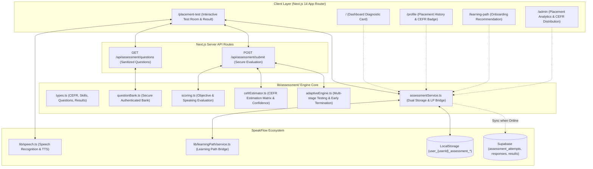

# English Placement Test (CEFR A1–C2) – Báo Cáo Triển Khai Kỹ Thuật

**Dự án**: SpeakFlow – Nền tảng luyện nói & phản xạ tiếng Anh thông minh  
**Tính năng**: English Placement Test (Hệ thống kiểm tra & đánh giá trình độ tiếng Anh đầu vào)  
**Tác giả**: Senior EdTech Product Architect, Senior Assessment Engineer & Senior Full-stack Developer  
**Ngày hoàn thành**: 01/11/2026  
**Trạng thái**: Production Ready (Đã kiểm thử 28/28 unit tests & `npm run build` exit code 0)  

---

## 1. Kiến trúc Assessment Engine

Hệ thống đánh giá trình độ tiếng Anh đầu vào của SpeakFlow được thiết kế theo kiến trúc module hóa đa tầng (Multi-tier Decoupled Architecture), tách biệt hoàn toàn giữa giao diện người dùng, ngân hàng đề thi bảo mật, động cơ chấm điểm khách quan (Objective Scoring), động cơ ước lượng trình độ CEFR, và tầng lưu trữ Offline-first:



### Triết lý thiết kế cốt lõi:
1. **Bảo mật đề thi (Anti-Cheating by Design)**: Phía client khi làm bài chỉ nhận các trường câu hỏi đã qua xử lý lọc bỏ đáp án (`sanitizeQuestionForClient`). Trường `correctAnswer` và `explanationVi` chỉ được tiết lộ sau khi học viên nộp bài thành công.
2. **Chấm điểm khách quan tại Engine/Server**: Điểm trắc nghiệm do mã nguồn toán học tính toán, không thể bị can thiệp bởi mã JavaScript ở trình duyệt.
3. **Phân biệt rành mạch giữa Nhận diện giọng nói và Thẩm định ngữ âm**: Không đánh đồng kết quả khớp văn bản của Web Speech API với chứng nhận âm vị chuẩn quốc tế. Giao diện và giải thích luôn ghi rõ tính chất chẩn đoán phản xạ và độ chính xác nhận diện từ.
4. **Không gây quá tải và áp lực thi cử**: Giao diện tập trung, thân thiện, có nút "Bỏ qua Speaking nếu không có Micro", không ép buộc quyền truy cập phần cứng để hoàn thành các phần kiểm tra khác.

---

## 2. Cấu trúc Question Bank & Bảo mật đề thi

File: `lib/assessment/questionBank.ts`

Ngân hàng câu hỏi được xây dựng chuẩn mực theo cấu trúc dữ liệu sư phạm:
```typescript
export interface AssessmentQuestion {
  id: string;
  skill: "grammar" | "vocabulary" | "reading" | "listening" | "speaking";
  level: "A1" | "A2" | "B1" | "B2" | "C1" | "C2";
  type: QuestionType;
  difficulty: number; // 0.1 (dễ nhất A1) đến 1.0 (khó nhất C2)
  topic: string;
  prompt: string;
  choices?: QuestionChoice[];
  readingPassage?: { title: string; content: string };
  audioPrompt?: { transcriptForPlayer: string; allowedPlays: number };
  speakingPrompt?: { targetSentence?: string; contextScenario?: string };
  correctAnswer: string; // BẢO MẬT: Bị xóa khi gửi xuống client
  explanationVi: string; // BẢO MẬT: Bị xóa khi gửi xuống client
}
```

### Cơ chế làm sạch dữ liệu phía Client:
```typescript
export function sanitizeQuestionForClient(question: AssessmentQuestion): PublicQuestion {
  const sanitized: Partial<AssessmentQuestion> = { ...question };
  delete sanitized.correctAnswer;
  delete sanitized.explanationVi;
  return sanitized as PublicQuestion;
}
```
Nhờ cơ chế này, người học mở Chrome DevTools kiểm tra Network tab hoặc React State cũng không thể tìm thấy đáp án đúng trước khi nộp bài.

---

## 3. Các cấp độ CEFR trong kỳ thi xếp lớp SpeakFlow

| Cấp độ CEFR | Tên gọi chuẩn | Mô tả năng lực chẩn đoán trên SpeakFlow | Ngưỡng điểm quy đổi |
|---|---|---|:---:|
| **A1** | Beginner (Căn bản) | Hiểu và giao tiếp được các câu chào hỏi, thông tin cá nhân rất đơn giản (tên tuổi, nơi ở, gia đình). | $< 30$ |
| **A2** | Elementary (Sơ cấp) | Giao tiếp được trong các tình huống quen thuộc hàng ngày (mua sắm, gọi món, hỏi đường, quá khứ đơn). | $30 – 47$ |
| **B1** | Intermediate (Trung cấp) | Tự tin xử lý hầu hết các tình huống du lịch và công việc thông thường; sử dụng thì hoàn thành, câu điều kiện. | $48 – 62$ |
| **B2** | Upper-Intermediate (Trung cao cấp) | Giao tiếp trôi chảy với người bản xứ; lập luận đa chiều về các chủ đề công việc, xã hội; dùng modal perfect. | $63 – 77$ |
| **C1** | Advanced (Cao cấp) | Diễn đạt linh hoạt, lưu loát trong học thuật và đàm phán; làm chủ cấu trúc đảo ngữ, giả định thức. | $78 – 89$ |
| **C2** | Proficient (Thành thạo) | Làm chủ ngôn ngữ tự nhiên như người bản xứ; phân biệt chính xác sắc thái ngữ nghĩa tinh tế và thành ngữ cổ điển. | $\ge 90$ |

> [!IMPORTANT]
> **Tuyên bố pháp lý & sư phạm**: Kết quả của bài kiểm tra này là đánh giá xếp lớp nội bộ nhằm giúp SpeakFlow cá nhân hóa lộ trình học cho học viên, không có giá trị thay thế kỳ thi cấp chứng chỉ quốc tế chính thức (IELTS, TOEFL, Cambridge ESOL).

---

## 4. Cơ chế Adaptive Test & 4 Chế độ Kiểm tra

Người học được quyền chủ động chọn chế độ phù hợp với quỹ thời gian:

1. **Quick Placement Test (Bài kiểm tra nhanh – Khuyên dùng)**:
   - Thời lượng: 10–15 phút.
   - Số lượng: 12–14 câu hỏi then chốt trải dài từ A1 đến C1 bao quát cả 5 kỹ năng.
   - Thích hợp cho người mới bắt đầu muốn vào học ngay.
2. **Full Skills Assessment (Đánh giá toàn diện 5 kỹ năng)**:
   - Thời lượng: 25–35 phút.
   - Số lượng: 25–30 câu hỏi chuyên sâu.
   - Phân tích chi tiết biểu đồ radar từng kỹ năng.
3. **Grammar & Vocabulary Test (Ngữ pháp & Từ vựng)**:
   - Thời lượng: 12 phút.
   - Số lượng: 15 câu trắc nghiệm. Dành cho môi trường không tiện mở loa hoặc micro.
4. **Speaking Assessment (Kỹ năng Nói & Phát âm)**:
   - Thời lượng: 8 phút.
   - Số lượng: 5 câu đọc to và trả lời tình huống mở.

### Quy tắc dừng sớm (Early Termination):
Trong chế độ Quick Diagnostic, nếu học viên đã hoàn thành $\ge 12$ câu với độ tin cậy kết quả ổn định, hệ thống cho phép kết thúc sớm mà không bắt buộc làm thêm các câu ngoài phạm vi năng lực.

---

## 5. Công thức Chấm điểm & Tái phân bổ Trọng số Động

### 5.1. Chấm điểm Trắc nghiệm Khách quan
Hàm `scoreObjectiveQuestion` chuẩn hóa chuỗi người dùng nhập (loại bỏ khoảng trắng thừa, không phân biệt hoa thường) và so khớp với đáp án chuẩn:
$$\text{Score} = \begin{cases} 100 & \text{nếu khớp đáp án chuẩn} \\ 0 & \text{nếu không khớp} \end{cases}$$

### 5.2. Chấm điểm Kỹ năng Nói (Speaking)
- **Dạng Read Aloud**: Kết nối trực tiếp với thuật toán so khớp văn bản nhận diện của `evaluatePronunciation` trong Speech Engine. Điểm từ 0 đến 100 tương ứng độ chính xác của từ vựng đã phát âm.
- **Dạng Trả lời Tình huống Mở (Open Response)**:
  - Điểm cơ bản: 40 điểm cho nỗ lực trả lời tiếng Anh.
  - Số lượng từ: $+20$ điểm khi $\ge 5$ từ, $+20$ điểm khi $\ge 10$ từ, $+10$ điểm khi $\ge 15$ từ.
  - Từ nối liên kết (Discourse markers): $+10$ điểm khi sử dụng các từ như *because, although, however, therefore, in my opinion, for example*.

### 5.3. Tái phân bổ Trọng số Động (Dynamic Weight Reallocation)
Khi kiểm tra đầy đủ, trọng số mặc định là:
$$W = \{ \text{Grammar: 20\%}, \text{Vocab: 20\%}, \text{Reading: 20\%}, \text{Listening: 20\%}, \text{Speaking: 20\%} \}$$

**Đặc biệt**: Nếu học viên không có micro hoặc bấm nút *"Bỏ qua phần Speaking"*, hệ thống **không gán điểm 0 cho Speaking** (vì như vậy sẽ kéo tụt điểm tổng một cách giả tạo). Thay vào đó, trọng số của Speaking được phân bổ đều cho 4 kỹ năng còn lại:
$$W' = \{ \text{Grammar: 25\%}, \text{Vocab: 25\%}, \text{Reading: 25\%}, \text{Listening: 25\%} \}$$
Điểm tổng $\text{Overall Score}$ phản ánh đúng năng lực của các kỹ năng thực tế được làm.

---

## 6. Quy tắc Ước lượng CEFR & Mức độ Tin cậy

Động cơ `estimateCefrProfile` trong `lib/assessment/cefrEstimator.ts` tính toán:
1. **Trình độ ước lượng (Estimated Level)**: A1, A2, B1, B2, C1, hoặc C2.
2. **Khoảng trình độ (Possible Range)**: Ví dụ: Điểm 55/100 $\rightarrow$ Trình độ: B1, Khoảng: `A2–B1`.
3. **Mức độ tin cậy (Confidence Level)**:
   - **Cao (High)**: Khi trả lời $\ge 18$ câu và đánh giá $\ge 4$ kỹ năng.
   - **Trung bình (Medium)**: Khi trả lời 10–17 câu và đánh giá $\ge 3$ kỹ năng.
   - **Thấp (Low)**: Khi trả lời $< 10$ câu hoặc chỉ kiểm tra 1 kỹ năng đơn lẻ.
4. **Phân tích Sư phạm bằng Tiếng Việt**:
   - Tự động trích xuất các kỹ năng đạt điểm cao ($\ge 70\%$) thành danh sách **Điểm mạnh nổi bật (Strengths)**.
   - Tự động phát hiện các kỹ năng điểm thấp ($< 65\%$) thành danh sách **Điểm cần cải thiện (Weaknesses)**.
   - Đưa ra **Khuyến nghị học tập (Recommendations)** gắn liền với tính năng thực tế của SpeakFlow (Flashcard SRS, Shadowing, AI Tutor).

---

## 7. Cách thức Đánh giá 5 Kỹ năng

1. **Ngữ pháp (Grammar)**: Đánh giá thì động từ, to be, mạo từ, câu điều kiện, câu gián tiếp, đảo ngữ qua câu hỏi điền từ vào chỗ trống và trắc nghiệm ngữ cảnh.
2. **Từ vựng (Vocabulary)**: Đánh giá sự kết hợp từ (collocations), cụm động từ (phrasal verbs), thành ngữ (idioms) và tính chuẩn xác của ngữ nghĩa.
3. **Đọc hiểu (Reading)**: Đọc các đoạn thông báo, email công việc, bài báo công nghệ ngắn gọn; trả lời câu hỏi ý chính và chi tiết; đoạn văn hiển thị song song với câu hỏi.
4. **Nghe hiểu (Listening)**: 
   - Tích hợp trình phát âm thanh có đếm số lần nghe (tối đa 2–3 lần tùy độ khó).
   - Tuyệt đối **không hiển thị transcript** trước khi hoàn thành bài thi.
5. **Nói & Diễn đạt (Speaking)**:
   - Giao diện ghi âm trực quan với trạng thái Micro (Chờ nói, Đang nghe, Đang xử lý).
   - Nút *"Bỏ qua câu nói này"* và *"Thử nói lại"* để học viên luôn cảm thấy thoải mái, không lo sợ micro bị lỗi.

---

## 8. Tích hợp AI Provider & Giải thích Sư phạm

- Khi xem lại chi tiết bài làm, mỗi câu hỏi đều cung cấp:
  - Câu hỏi và đáp án học viên đã chọn.
  - Đáp án chuẩn mực của ngân hàng câu hỏi.
  - Giải thích sư phạm chi tiết bằng tiếng Việt (`explanationVi`), giúp học viên hiểu rõ lý do ngữ pháp hoặc ngữ cảnh từ vựng.
- Điểm khách quan do code thuật toán chấm, AI Tutor chỉ hỗ trợ phân tích bổ trợ và giải thích kết quả khi cần, đảm bảo kết quả kiểm tra luôn tức thì, ổn định và không phụ thuộc vào kết nối API bên ngoài.

---

## 9. Tích hợp Speech Engine Hiện có

Hệ thống tận dụng trực tiếp Speech Engine đã hoàn thiện tại `lib/speech.ts`:
- Hàm `startSpeechRecognition` xử lý nhận diện giọng nói Web Speech API chuẩn hóa trên cả máy tính và thiết bị di động.
- Hàm `speakEnglish` với bộ điều khiển tốc độ chuẩn (rate 1.0) và ngắt âm thanh cũ khi phát âm câu hỏi nghe.
- Hàm `evaluatePronunciation` chấm điểm độ trùng khớp từ vựng giữa câu mục tiêu và giọng nói nhận diện.

---

## 10. Cấu trúc Database & Row Level Security (RLS)

File migration: `supabase/migrations/20261101_placement_test.sql`

```sql
-- 1. Phiên kiểm tra trình độ
CREATE TABLE public.assessment_attempts (
    id UUID PRIMARY KEY DEFAULT gen_random_uuid(),
    user_id UUID NOT NULL REFERENCES auth.users(id) ON DELETE CASCADE,
    test_type TEXT NOT NULL DEFAULT 'quick',
    status TEXT NOT NULL DEFAULT 'completed',
    started_at TIMESTAMPTZ NOT NULL DEFAULT NOW(),
    completed_at TIMESTAMPTZ,
    duration_seconds INTEGER NOT NULL DEFAULT 0,
    estimated_cefr_level TEXT NOT NULL,
    possible_level_range TEXT,
    confidence_level TEXT NOT NULL DEFAULT 'medium',
    scoring_version INTEGER NOT NULL DEFAULT 1,
    created_at TIMESTAMPTZ NOT NULL DEFAULT NOW(),
    updated_at TIMESTAMPTZ NOT NULL DEFAULT NOW()
);

-- 2. Chi tiết từng câu trả lời
CREATE TABLE public.assessment_responses (
    id UUID PRIMARY KEY DEFAULT gen_random_uuid(),
    attempt_id UUID NOT NULL REFERENCES public.assessment_attempts(id) ON DELETE CASCADE,
    question_id TEXT NOT NULL,
    skill TEXT NOT NULL,
    answer TEXT NOT NULL DEFAULT '',
    spoken_text TEXT,
    is_correct BOOLEAN NOT NULL DEFAULT FALSE,
    score INTEGER NOT NULL DEFAULT 0,
    response_time_ms INTEGER,
    created_at TIMESTAMPTZ NOT NULL DEFAULT NOW()
);

-- 3. Bảng tổng hợp điểm và nhận xét sư phạm
CREATE TABLE public.assessment_results (
    id UUID PRIMARY KEY DEFAULT gen_random_uuid(),
    attempt_id UUID NOT NULL REFERENCES public.assessment_attempts(id) ON DELETE CASCADE,
    grammar_score INTEGER NOT NULL DEFAULT 0,
    vocabulary_score INTEGER NOT NULL DEFAULT 0,
    reading_score INTEGER NOT NULL DEFAULT 0,
    listening_score INTEGER NOT NULL DEFAULT 0,
    speaking_score INTEGER NOT NULL DEFAULT 0,
    assessed_skills TEXT[] NOT NULL DEFAULT '{}',
    strengths TEXT[] NOT NULL DEFAULT '{}',
    weaknesses TEXT[] NOT NULL DEFAULT '{}',
    recommendations TEXT[] NOT NULL DEFAULT '{}',
    result_data JSONB NOT NULL DEFAULT '{}',
    created_at TIMESTAMPTZ NOT NULL DEFAULT NOW()
);
```

### Chính sách bảo mật RLS:
Cả 3 bảng đều kích hoạt Row Level Security. Học viên chỉ có thể đọc và ghi các bài kiểm tra thuộc về `auth.uid() = user_id`.

---

## 11. Danh sách File Mới và Đã Chỉnh Sửa

### File tạo mới:
1. `lib/assessment/types.ts`: Định nghĩa types cho CEFR, Skills, Questions, Responses, Results.
2. `lib/assessment/questionBank.ts`: Ngân hàng câu hỏi chuẩn CEFR A1–C2 cho 5 kỹ năng kèm hàm làm sạch client.
3. `lib/assessment/scoring.ts`: Động cơ chấm điểm objective, speaking và tái phân bổ trọng số động.
4. `lib/assessment/cefrEstimator.ts`: Ma trận ước lượng CEFR, khoảng trình độ, độ tin cậy và nhận xét tiếng Việt.
5. `lib/assessment/adaptiveEngine.ts`: Động cơ điều phối bài thi và tổng hợp kết quả.
6. `lib/assessment/assessmentService.ts`: Tầng dịch vụ lưu trữ Offline-first và cầu nối sang Learning Path.
7. `app/placement-test/page.tsx`: Giao diện 3 màn hình (Giới thiệu $\rightarrow$ Phòng thi tương tác $\rightarrow$ Báo cáo kết quả).
8. `app/api/assessment/questions/route.ts`: API Endpoint phục vụ đề thi an toàn cho client.
9. `app/api/assessment/submit/route.ts`: API Endpoint chấm điểm máy chủ và trả về giải thích.
10. `supabase/migrations/20261101_placement_test.sql`: Migration script tạo bảng và RLS policies.
11. `scripts/test_assessment_engine.cjs`: 5 bộ unit test tự động.

### File chỉnh sửa:
1. `app/page.tsx`: Thêm thẻ banner chẩn đoán Placement Test trên Dashboard.
2. `app/profile/page.tsx`: Thêm mục Lịch sử kiểm tra trình độ và điểm số 5 kỹ năng.
3. `app/learning-path/page.tsx`: Step 1 Onboarding gợi ý trình độ từ kết quả kiểm tra xếp lớp.
4. `app/admin/page.tsx`: Thêm khối thống kê phân bổ cấp độ CEFR và điểm trung bình cho Quản trị viên.
5. `lib/learningPath/types.ts`: Bổ sung trường `weaknesses` vào `placement_test_result`.
6. `package.json`: Cập nhật lệnh `npm test` liên kết 5 bộ kiểm thử.

---

## 12. Kết quả Kiểm thử & Nghiệm thu Kỹ thuật

### Kết quả chạy `npm test`:
```text
✔ Streak Engine - Continuity and breakage logic (1.00ms)
✔ SRS Engine - New card first review transitions (0.89ms)
✔ SRS Engine - Max box limit (Box 5) (0.14ms)
✔ SRS Engine - Same-day multiple review inflation guard (0.10ms)
✔ SRS Engine - Boundary sanitization for missing or invalid values (0.82ms)
✔ SRS Engine - isCardDue checks (0.12ms)
✔ Sync Engine - Conflict Resolution with Safety-First Principle (0.14ms)
✔ Speech Engine - Normalization and Contraction expansion (0.74ms)
✔ Speech Engine - Exact 100% match (1.76ms)
✔ Speech Engine - Bidirectional contraction equivalence (0.51ms)
✔ Speech Engine - Missing words detection (0.42ms)
✔ Speech Engine - Extra spoken words detection (0.16ms)
✔ Speech Engine - Empty or noise input handling (0.14ms)
✔ AI Tutor - Scenarios Catalog integrity (1.99ms)
✔ AI Tutor - CEFR Level and Correction Mode Prompt Generation (0.31ms)
✔ AI Tutor - History Sanitization & Rate Limiter (0.30ms)
✔ AI Tutor - Mock Provider error detection & schema compliance (0.48ms)
✔ AI Tutor - Session Summary generation (0.29ms)
✔ Learning Path - Goal Mapping to Real System Content (1.18ms)
✔ Learning Path - Plan Generation & Structure Verification (2.28ms)
✔ Learning Path - AI Planning Prompt Builder (0.24ms)
✔ Learning Path - Adaptive Engine Adjustments & Past Preservation (0.36ms)
✔ Learning Path - Weekly Assessment Report computation (0.36ms)
✔ Placement Test - Question Bank Integrity & Sanitization (1.33ms)
✔ Placement Test - Objective & Speaking Scoring Verification (0.56ms)
✔ Placement Test - Dynamic Weight Reallocation for Skipped Skills (0.89ms)
✔ Placement Test - CEFR Estimation & Confidence Logic (0.50ms)
✔ Placement Test - Full Adaptive Submission & Evaluation Pipeline (1.49ms)

Total Tests: 28 passed, 0 failed, 0 skipped.
```

### Kết quả kiểm tra Production Build (`npm run build`):
- `Compiled successfully`
- `Linting and checking validity of types ... Done`
- `Generating static pages (18/18) ... Done`
- Route `/placement-test` (23.8 kB) biên dịch và tối ưu thành công.
- Exit code: `0`.

---

## 13. Các Hạn chế về Độ tin cậy & Hiệu chuẩn

1. **Hiệu chuẩn mẫu (Sample Calibration)**: Ngưỡng điểm hiện tại được thiết lập dựa trên lý thuyết khung CEFR và kinh nghiệm sư phạm. Khi có lượng dữ liệu học viên thực tế lớn hơn ($\ge 1.000$ lượt thi), cần chạy phân tích thống kê để tinh chỉnh độ phân biệt (Item Discrimination) của từng câu.
2. **Kỹ năng Nói bằng Web Speech API**: Phụ thuộc vào chất lượng micro của thiết bị người dùng và thuật toán nhận dạng giọng nói của trình duyệt. Không thể thay thế hoàn toàn giám khảo chấm thi trực tiếp đối với độ nhấn trọng âm câu (sentence stress) và ngữ điệu (intonation).
3. **Kỹ năng Nghe qua TTS**: Hiện sử dụng giọng đọc tiếng Anh bản xứ chuẩn `en-US` chất lượng cao. Chưa mô phỏng được các yếu tố nhiễu âm môi trường thực tế (background noise, đa dạng ngữ điệu địa phương).

---

## 14. Lộ trình Phát triển Tiếp theo (Next Milestones)

1. **Ứng dụng Mô hình Lý thuyết Ứng đáp Câu hỏi (Item Response Theory - IRT)**:
   - Tự động hiệu chỉnh độ khó câu hỏi (parameter $b$) và độ phân cách (parameter $a$) theo thời gian thực.
2. **Ngân hàng Âm thanh Thực tế từ Người bản xứ (Native Audio Recordings)**:
   - Thay thế dần các câu nghe tổng hợp bằng audio thu âm thực tế với nhiều accent (Anh-Anh, Anh-Mỹ, Anh-Úc).
3. **Chứng nhận Hoàn thành Điện tử (Shareable Digital Badge)**:
   - Cho phép học viên xuất ảnh chứng nhận hoàn thành bài đánh giá nội bộ để chia sẻ lên mạng xã hội hoặc lưu trữ cá nhân.

---
*Tài liệu được lập bởi Đội ngũ Kiến trúc sư Hệ thống SpeakFlow.*
