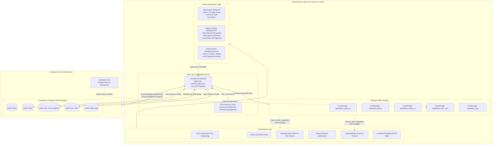
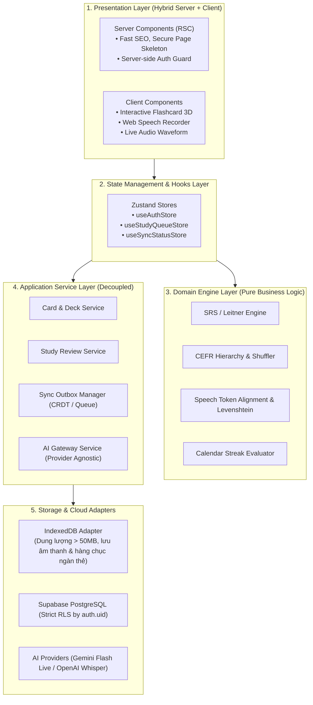

# BÁO CÁO PHÂN TÍCH TOÀN DIỆN VÀ ĐÁNH GIÁ KIẾN TRÚC HỆ THỐNG SPEAKFLOW
**Tác giả:** Senior Software Architect & Product Engineer  
**Đối tượng:** Đội ngũ Kỹ thuật & AI phát triển tiếp theo  
**Thời điểm đánh giá:** Tháng 11/2026  
**Mã nguồn khảo sát:** SpeakFlow Web Application (Next.js 14 App Router, Supabase, Web Speech API)

---

## MỤC LỤC
1. [PHẦN 1 – Tổng quan hiện trạng hệ thống](#phần-1--tổng-quan-hiện-trạng-hệ-thống)
2. [PHẦN 2 – Sơ đồ kiến trúc thực tế (Architecture Diagrams)](#phần-2--sơ-đồ-kiến-trúc-thực-tế-architecture-diagrams)
3. [PHẦN 3 – Danh sách vấn đề phát hiện (Audit Findings)](#phần-3--danh-sách-vấn-đề-phát-hiện-audit-findings)
4. [PHẦN 4 – Đánh giá chất lượng từng module (Scoring)](#phần-4--đánh-giá-chất-lượng-từng-module-scoring)
5. [PHẦN 5 – Đề xuất kiến trúc cải tiến (Target Architecture)](#phần-5--đề-xuất-kiến-trúc-cải-tiến-target-architecture)
6. [PHẦN 6 – Roadmap phát triển (Phases 1 – 4)](#phần-6--roadmap-phát-triển-phases-1--4)
7. [PHẦN 7 – Danh sách 10 việc cần thực hiện đầu tiên (Top 10 Action Items)](#phần-7--danh-sách-10-việc-cần-thực-hiện-đầu-tiên-top-10-action-items)

---

## PHẦN 1 – TỔNG QUAN HIỆN TRẠNG HỆ THỐNG

### 1.1. Bức tranh kiến trúc thực tế
SpeakFlow là ứng dụng Web học phản xạ giao tiếp tiếng Anh được xây dựng trên nền tảng **Next.js 14 App Router** kết hợp với **Supabase Backend** và **LocalStorage**.

Tuy nhiên, khảo sát thực tế toàn bộ mã nguồn cho thấy:
- **100% Client-Side Rendering (CSR)**: Tất cả các route (`/`, `/study`, `/reflex`, `/manage`, `/profile`, `/admin`, `/roleplay`, `/deck/[id]`, `/login`) đều được đánh dấu directive `"use client"`. Hệ thống chưa tận dụng kiến trúc **React Server Components (RSC)**, Server Actions, hay Next.js Route Handlers (`app/api/*`). Toàn bộ việc nạp dữ liệu và kiểm tra trạng thái diễn ra tại trình duyệt người dùng thông qua các hook `useEffect` và `useState`.
- **Mô hình Dữ liệu "God Service"**: File [`lib/dataService.ts`](file:///e:/Code/Giao%20ti%E1%BA%BFp%20ti%E1%BA%BFng%20anh/lib/dataService.ts) gánh vác gần như toàn bộ logic của hệ thống với **3.923 dòng code**. File này tập trung từ xác thực Auth, quản lý tài khoản demo, bộ nhớ đệm RAM, CRUD thẻ và bộ thẻ, tính toán streak, ghi nhật ký, đến thuật toán đồng bộ đám mây và báo cáo thống kê của quản trị viên.
- **Quản lý trạng thái phân tán qua DOM Events**: Ứng dụng không sử dụng State Store tập trung (như Zustand hay Redux). Thay vào đó, sự đồng bộ giữa các thành phần độc lập (`TopHeaderBar`, `HomePage`, `AdminDashboardPage`) dựa trên `window.localStorage` kết hợp việc phát sự kiện thủ công qua `window.dispatchEvent(new Event("speakflow-auth-changed"))`.
- **Dữ liệu hạt giống (Seed Data)**: Hệ thống sở hữu 6 bộ chủ đề giao tiếp với **108 câu mẫu**, được phân bổ đồng đều theo 6 cấp độ CEFR ($A1 \to C2$, mỗi cấp độ đúng 3 câu/chủ đề).

### 1.2. Danh mục Modules và Vai trò
| Module | Vị trí file | Trách nhiệm chính |
| :--- | :--- | :--- |
| **Data & Auth Core** | [`lib/dataService.ts`](file:///e:/Code/Giao%20ti%E1%BA%BFp%20ti%E1%BA%BFng%20anh/lib/dataService.ts) | Quản lý Supabase Client, LocalStorage, Auth State, CRUD Cards/Decks, Sync engine, Stats |
| **SRS Engine** | [`lib/srs.ts`](file:///e:/Code/Giao%20ti%E1%BA%BFp%20ti%E1%BA%BFng%20anh/lib/srs.ts) | Thuật toán SM-2 rút gọn + Leitner 5 hộp ghi nhớ, tính `interval_days`, `ease_factor`, `next_review_at` |
| **Speech Engine** | [`lib/speech.ts`](file:///e:/Code/Giao%20ti%E1%BA%BFp%20ti%E1%BA%BFng%20anh/lib/speech.ts) | Nhận diện giọng nói (`webkitSpeechRecognition`), Text-to-Speech (`speechSynthesis`), Needleman-Wunsch DP + Levenshtein so khớp từ |
| **Content Seed** | [`lib/seedData.ts`](file:///e:/Code/Giao%20ti%E1%BA%BFp%20ti%E1%BA%BFng%20anh/lib/seedData.ts) | 108 câu mẫu chuẩn CEFR A1-C2, metadata CEFR, danh sách 6 bộ chủ đề hệ thống |
| **Database DDL** | [`supabase/schema.sql`](file:///e:/Code/Giao%20ti%E1%BA%BFp%20ti%E1%BA%BFng%20anh/supabase/schema.sql) | DDL tạo bảng `decks`, `cards`, `user_card_progress`, `user_stats`, RLS policies, seed insert |
| **Flashcard Study** | [`app/study/page.tsx`](file:///e:/Code/Giao%20ti%E1%BA%BFp%20ti%E1%BA%BFng%20anh/app/study/page.tsx) | Flashcard 3D Active Recall, phím tắt (Space, H, R, S, M, 1-4), Shadowing Studio, Quick CEFR filter |
| **Reflex Drill** | [`app/reflex/page.tsx`](file:///e:/Code/Giao%20ti%E1%BA%BFp%20ti%E1%BA%BFng%20anh/app/reflex/page.tsx) | Thử thách phản xạ 60 giây, nhận diện giọng nói tự động 7s/câu, bảng tổng kết từ vựng |
| **Decks & Cards** | [`app/manage/page.tsx`](file:///e:/Code/Giao%20ti%E1%BA%BFp%20ti%E1%BA%BFng%20anh/app/manage/page.tsx) | Tạo thẻ lẻ, Import CSV/JSON, lọc theo bộ thẻ và CEFR, kiểm soát bộ hệ thống |
| **Deck Detail** | [`app/deck/[id]/page.tsx`](file:///e:/Code/Giao%20ti%E1%BA%BFp%20ti%E1%BA%BFng%20anh/app/deck/%5Bid%5D/page.tsx) | Xem trước câu trong bộ chia sẻ, nghe audio mẫu, Clone/Fork về kho cá nhân |
| **Roleplay** | [`app/roleplay/page.tsx`](file:///e:/Code/Giao%20ti%E1%BA%BFp%20ti%E1%BA%BFng%20anh/app/roleplay/page.tsx) | Thực hành hội thoại theo tình huống tĩnh (3 kịch bản mẫu) |
| **Admin Portal** | [`app/admin/page.tsx`](file:///e:/Code/Giao%20ti%E1%BA%BFp%20ti%E1%BA%BFng%20anh/app/admin/page.tsx) | Bảng theo dõi học viên, lọc KPI, khóa tài khoản, reset tiến trình học tập |
| **Profile** | [`app/profile/page.tsx`](file:///e:/Code/Giao%20ti%E1%BA%BFp%20ti%E1%BA%BFng%20anh/app/profile/page.tsx) | Phân tích 5 hộp nhớ, điểm danh 7 ngày, danh sách từ phát âm hay sai |

---

## PHẦN 2 – SƠ ĐỒ KIẾN TRÚC THỰC TẾ (ARCHITECTURE DIAGRAMS)

---

## PHẦN 3 – DANH SÁCH VẤN ĐỀ PHÁT HIỆN (AUDIT FINDINGS)

Dưới đây là bảng tổng hợp chi tiết các lỗi đã xác nhận, rủi ro tiềm ẩn và hạn chế kỹ thuật được trích xuất trực tiếp từ mã nguồn:

| ID | Module | Vấn đề | Mức độ | Bằng chứng trong code | Hướng xử lý đề xuất |
| :--- | :--- | :--- | :---: | :--- | :--- |
| **SEC-01** | Database RLS | **RLS bị vô hiệu hóa logic**: Tất cả các bảng cho phép mọi client đọc/ghi toàn bộ | **Critical** | [`supabase/schema.sql` (L100, L106, L112, L118)](file:///e:/Code/Giao%20ti%E1%BA%BFp%20ti%E1%BA%BFng%20anh/supabase/schema.sql#L97-L119): `CREATE POLICY ... FOR ALL USING (true) WITH CHECK (true);` | Viết lại chính sách RLS chuẩn: Thẻ của user nào chỉ user đó `auth.uid() = user_id` được sửa/xóa; Bảng hệ thống chỉ đọc. |
| **SEC-02** | Admin Auth | **Phân quyền Quản trị hoàn toàn ở Client**: Bất kỳ ai sửa `localStorage` đều vào được Admin | **Critical** | [`app/admin/page.tsx` (L118-L121)](file:///e:/Code/Giao%20ti%E1%BA%BFp%20ti%E1%BA%BFng%20anh/app/admin/page.tsx#L118-L121): `const user = getStoredUserProfile(); if (user?.role === "admin")` | Chuyển xác thực quyền Admin vào Next.js Middleware hoặc Supabase Custom Claims (`app_metadata.role`). |
| **SEC-03** | Secrets & Config | **Khóa Supabase cứng trong mã nguồn**: Fallback lộ public anon key và URL | **High** | [`lib/dataService.ts` (L27-L29)](file:///e:/Code/Giao%20ti%E1%BA%BFp%20ti%E1%BA%BFng%20anh/lib/dataService.ts#L27-L29): `DEFAULT_SUPABASE_URL = "..."`, `DEFAULT_SUPABASE_KEY = "..."` | Xóa hoàn toàn chuỗi fallback nhạy cảm, chỉ đọc duy nhất từ `process.env.NEXT_PUBLIC_*`. Báo lỗi rõ nếu thiếu env. |
| **DAT-01** | Data Sync | **Thẻ tạo Offline không bao giờ được đồng bộ lên Cloud**: `syncUserProgressWithCloud` chỉ sync progress, không sync cards mới | **High** | [`lib/dataService.ts` (L2298-L2331, L3270-L3287)](file:///e:/Code/Giao%20ti%E1%BA%BFp%20ti%E1%BA%BFng%20anh/lib/dataService.ts#L2298-L2331): `addCard` khi offline chỉ lưu `localStorage`, hàm sync đám mây bỏ qua mảng custom cards chưa đẩy. | Triển khai **Sync Outbox Pattern** (Hàng đợi thao tác offline): Mọi lệnh tạo/sửa thẻ offline được lưu vào queue và đẩy tuần tự khi online. |
| **DAT-02** | CSV Import | **Thuật toán tách CSV ngây thơ làm hỏng dữ liệu**: Dùng `.split(",")` phá vỡ câu có dấu phẩy | **High** | [`app/manage/page.tsx` (L105)](file:///e:/Code/Giao%20ti%E1%BA%BFp%20ti%E1%BA%BFng%20anh/app/manage/page.tsx#L105): `const parts = lines[i].split(",").map(...)` | Thay thế bằng Regex parse CSV chuẩn RFC 4180 hoặc thư viện chuyên dụng như `papaparse` để hỗ trợ chuỗi có dấu ngoặc kép `"..."`. |
| **SRS-01** | Learning Engine | **Không khống chế khoảng cách ôn tập nhiều lần trong ngày**: Cùng ngày bấm "good" nhiều lần sẽ đẩy interval vọt xà | **Medium** | [`lib/srs.ts` (L53)](file:///e:/Code/Giao%20ti%E1%BA%BFp%20ti%E1%BA%BFng%20anh/lib/srs.ts#L53): `interval = Math.max(3, Math.round(interval * ease));` | Nếu `last_practiced_at` rơi vào cùng ngày hôm nay, chỉ cập nhật kết quả mà không nhân số nhân `interval` liên tiếp. |
| **SRS-02** | Learning Engine | **Xung đột thời gian ôn tập "Again"**: Tài liệu ghi 10 phút, code thực tế là 1 phút | **Low** | [`lib/srs.ts` (L38)](file:///e:/Code/Giao%20ti%E1%BA%BFp%20ti%E1%BA%BFng%20anh/lib/srs.ts#L38): `nextReviewDate = new Date(now.getTime() + 60 * 1000);` | Thống nhất cấu hình thời gian ôn lại: Cho phép cấu hình linh hoạt (ví dụ 10 phút hoặc 1 phút theo cài đặt của học viên). |
| **SPE-01** | Speech Engine | **Trình duyệt Firefox không hỗ trợ Web Speech Recognition**: Không có fallback Speech-to-Text | **High** | [`lib/speech.ts` (L752)](file:///e:/Code/Giao%20ti%E1%BA%BFp%20ti%E1%BA%BFng%20anh/lib/speech.ts#L752): `const SpeechRecognition = window.SpeechRecognition || window.webkitSpeechRecognition;` | Thêm cảnh báo giao diện trên Firefox; chuẩn bị Web Audio API ghi âm `.wav` gửi lên Backend Whisper/Gemini Audio API. |
| **SPE-02** | Speech Engine | **Nhầm lẫn giữa Nhận diện chữ (ASR) và Phát âm chuẩn (Phonetics)**: Google ASR tự sửa lỗi người nói | **Medium** | [`lib/speech.ts` (L400-L465)](file:///e:/Code/Giao%20ti%E1%BA%BFp%20ti%E1%BA%BFng%20anh/lib/speech.ts#L400-L465): Chỉ đo Levenshtein trên văn bản phiên mã ASR trả về, không phân tích formants hay ngữ điệu âm vị. | Bổ sung lộ trình tích hợp Audio AI Coach (phân tích ngữ âm/âm vị phoneme-level) ở Giai đoạn 3. |
| **ARCH-01**| Code Structure | **God Object File `lib/dataService.ts`**: Gần 4.000 dòng code trong 1 file | **Medium** | [`lib/dataService.ts`](file:///e:/Code/Giao%20ti%E1%BA%BFp%20ti%E1%BA%BFng%20anh/lib/dataService.ts) (3.923 dòng) | Tách thành các service chuyên biệt: `authService`, `cardService`, `deckService`, `streakService`, `syncService`, `adminService`. |
| **UI-01**  | Roleplay | **Tính năng Roleplay chỉ là kịch bản tĩnh**: Chưa có tính tương tác hai chiều | **Low** | [`app/roleplay/page.tsx` (L42-L77)](file:///e:/Code/Giao%20ti%E1%BA%BFp%20ti%E1%BA%BFng%20anh/app/roleplay/page.tsx#L42-L77): Chỉ có 3 object tĩnh, người dùng đọc câu cố định. | Nâng cấp tích hợp Gemini Live/Chat để đàm thoại nhập vai động theo ngữ cảnh thực tế. |

---

## PHẦN 4 – ĐÁNH GIÁ CHẤT LƯỢNG TỪNG MODULE (SCORING)

| Tiêu chí | Điểm (1–10) | Nhận xét kiến trúc & Căn cứ đánh giá |
| :--- | :---: | :--- |
| **1. Kiến trúc tổng thể** | **6.5 / 10** | Cấu trúc thư mục Next.js rõ ràng, giao diện hiện đại. Tuy nhiên việc 100% là Client Components, thiếu API routes/middleware và phụ thuộc vào 1 file `dataService.ts` đồ sộ làm giảm tính module hóa. |
| **2. Chất lượng code** | **7.0 / 10** | TypeScript định kiểu khá chặt chẽ, code có chú thích và phân tách hàm. Tuy nhiên xuất hiện nhiều đoạn trùng lặp và code xử lý chuỗi còn ngây thơ (như split CSV). |
| **3. Data & Sync** | **5.5 / 10** | **Điểm yếu lớn nhất**. Hỗ trợ Offline-first thông qua LocalStorage nhanh, nhưng thuật toán đồng bộ đám mây còn nhiều lỗ hổng: không có outbox queue cho thẻ tạo offline, nguy cơ race-condition khi học đa thiết bị, và phụ thuộc hoàn toàn vào client timestamp. |
| **4. Learning Engine** | **8.0 / 10** | Kết hợp thông minh giữa SM-2 và Leitner 5 hộp. Logic CEFR 6 cấp độ kèm bộ chọn Modal và xáo trộn Fisher-Yates hoạt động rất mượt mà. Cần chặn việc spam "good" nhiều lần trong ngày. |
| **5. Speech & Pronunciation**| **7.5 / 10** | Xử lý từ co gọn (contractions) rất chi tiết. Thuật toán Needleman-Wunsch DP so khớp từ giúp tránh bị lệch thứ tự khi học viên đọc thiếu từ. Điểm trừ là phụ thuộc `webkitSpeechRecognition` (không chạy trên Firefox). |
| **6. Giao diện (UI/UX)** | **8.5 / 10** | Giao diện xuất sắc, màu sắc học tập thân thiện, animation lật 3D Framer Motion mượt mà, hỗ trợ phím tắt Space/M/R/S/1-4 chuẩn Active Recall, trải nghiệm mobile responsive tốt. |
| **7. Bảo mật (Security)** | **4.0 / 10** | **Báo động đỏ**. RLS Supabase đang mở toang `USING(true)`, phân quyền Admin kiểm tra ở LocalStorage phía client, hardcode URL/Key trong code. Cần khắc phục ngay trước khi đưa vào sản xuất. |
| **8. Hiệu năng (Performance)**| **7.5 / 10** | Đọc dữ liệu từ RAM Cache và LocalStorage chỉ mất dưới 1ms. Giao diện tải nhanh. Nhưng khi kho thẻ tăng lên hàng chục ngàn câu, việc nhồi tất cả vào 1 mảng JSON trong `localStorage` sẽ gây tràn bộ nhớ 5MB của trình duyệt. |
| **9. Khả năng mở rộng** | **6.0 / 10** | Dễ dàng mở rộng thêm câu hỏi và chủ đề. Nhưng để tích hợp AI Tutor, Voice Agent, hay mở rộng sang B2B EdTech thì kiến trúc hiện tại bắt buộc phải tái cấu trúc tầng Service và bảo mật. |

---

## PHẦN 5 – ĐỀ XUẤT KIẾN TRÚC CẢI TIẾN (TARGET ARCHITECTURE)

Để hệ thống sẵn sàng mở rộng các tính năng AI, Voice Agent và xử lý quy mô lớn, kiến trúc đích đề xuất như sau:

### Các nguyên tắc cốt lõi của Kiến trúc đích:
1. **Phân tách trách nhiệm (Separation of Concerns)**:
   - Xóa bỏ God Object: Tách `lib/dataService.ts` thành `services/card.service.ts`, `services/streak.service.ts`, `services/sync.service.ts`, `services/auth.service.ts`.
2. **IndexedDB thay thế LocalStorage cho kho thẻ lớn**:
   - `localStorage` bị giới hạn nghiêm ngặt ở 5MB và là synchronous (block main thread). Sử dụng `idb-keyval` hoặc IndexedDB giúp SpeakFlow lưu trữ hàng ngàn câu và thậm chí cả file âm thanh cached mà không lo giật lag.
3. **Outbox Pattern cho đồng bộ Offline**:
   - Khi tạo thẻ hoặc review thẻ lúc mất mạng: Lưu thao tác vào `sync_queue` trong IndexedDB kèm `client_timestamp` và `mutation_id`.
   - Khi có mạng: `SyncManager` phát tuần tự các mutation lên Cloud.
4. **AI Gateway Pattern (Không phụ thuộc cứng nhà cung cấp)**:
   - Tạo Interface `AITutorProvider` với các phương thức `generateRoleplayReply()`, `analyzePronunciation()`.
   - Có thể cắm rút linh hoạt giữa **Google Gemini 1.5 Flash**, **OpenAI GPT-4o-mini**, hoặc **Whisper** mà không làm thay đổi giao diện.
5. **Bảo mật tuyệt đối**:
   - Toàn bộ quyền Admin chuyển về Next.js Middleware kiểm tra JWT claims.
   - Database Supabase thiết lập RLS chặt chẽ: `auth.uid() = user_id`.

---

## PHẦN 6 – ROADMAP PHÁT TRIỂN (4 GIAI ĐOẠN)

### GIAI ĐOẠN 1: Sửa lỗi bảo mật & Củng cố nền tảng (Foundation Hardening)
- **Mục tiêu**: Bịt kín các lỗ hổng bảo mật, bảo vệ dữ liệu người dùng và chia tách module code dễ bảo trì.
- **Phạm vi công việc**:
  1. Thiết lập RLS policies chuẩn xác trên Supabase cho cả 5 bảng.
  2. Bổ sung Server-side Guard cho route `/admin` thông qua Next.js Middleware.
  3. Xóa các biến bí mật hardcoded trong `lib/dataService.ts`.
  4. Nâng cấp bộ phân tích cú pháp CSV (`parseCsvBatch`) hỗ trợ dấu phẩy trong ngoặc kép.
  5. Chia tách `lib/dataService.ts` thành các module dịch vụ độc lập.
- **File ảnh hưởng**: `supabase/schema.sql`, `middleware.ts`, `lib/dataService.ts`, `app/manage/page.tsx`, `app/admin/page.tsx`.
- **Mức độ ưu tiên**: **P0 (Bắt buộc làm ngay)**.
- **Tiêu chí nghiệm thu**: Học viên thông thường không thể truy cập `/admin`; Client nặc danh không thể đọc trộm dữ liệu người khác; file CSV phức tạp import thành công 100%.

---

### GIAI ĐOẠN 2: Nâng cấp trải nghiệm học tập & PWA Offline (Learning UX & PWA)
- **Mục tiêu**: Tối ưu chu kỳ ghi nhớ SRS, hỗ trợ âm thanh chất lượng cao và khả năng cài đặt như ứng dụng di động.
- **Phạm vi công việc**:
  1. Hoàn thiện Outbox Sync Queue cho các thao tác offline.
  2. Khống chế SRS không cho tăng interval phi mã khi học dồn nhiều lần trong ngày.
  3. Tích hợp Manifest PWA (`manifest.json`) và Service Worker để cài đặt app lên iOS/Android.
  4. Thông báo đẩy (Web Push Notifications) nhắc nhở học vào 20:00 tối khi trạng thái Streak là `at_risk`.
  5. Cảnh báo thông minh trên các trình duyệt không hỗ trợ Web Speech API (Firefox/Safari cũ).
- **File ảnh hưởng**: `lib/srs.ts`, `lib/syncService.ts`, `public/manifest.json`, `app/layout.tsx`.
- **Mức độ ưu tiên**: **P1 (Quan trọng)**.
- **Tiêu chí nghiệm thu**: App cài được lên màn hình điện thoại; mất mạng tạo thẻ vẫn sync chuẩn khi có mạng; nhận được notification nhắc streak.

---

### GIAI ĐOẠN 3: Tích hợp Trợ lý AI & Luyện phát âm chuyên sâu (AI Tutor & Voice Agent)
- **Mục tiêu**: Đưa SpeakFlow thành gia sư tiếng Anh thông minh với phản xạ giao tiếp hai chiều.
- **Phạm vi công việc**:
  1. **AI Roleplay Dynamic**: Thay thế 3 kịch bản tĩnh trong `/roleplay` bằng hội thoại AI động qua **Gemini API** (nhập vai phỏng vấn xin việc, đàm phán hợp đồng, order đồ ăn).
  2. **AI Pronunciation Coach**: Bổ sung cơ chế ghi âm audio gửi lên backend để phân tích ngữ điệu, trọng âm và phát hiện âm vị sai (thay vì chỉ so sánh chữ của Web Speech).
  3. **AI Flashcard Generator**: Cho phép người dùng paste một đoạn văn bản hoặc hội thoại, AI tự động trích xuất các câu giao tiếp trọng tâm, sinh nghĩa tiếng Việt, phiên âm IPA và cấp độ CEFR tương ứng.
- **File ảnh hưởng**: `app/roleplay/page.tsx`, `app/manage/page.tsx`, `lib/ai/gemini.ts`, `app/api/ai/*`.
- **Mức độ ưu tiên**: **P1 (Cốt lõi sản phẩm)**.
- **Tiêu chí nghiệm thu**: Người dùng trò chuyện liên tục với AI qua giọng nói; tạo bộ thẻ 10 câu bằng AI chỉ trong 3 giây.

---

### GIAI ĐOẠN 4: Cá nhân hóa lộ trình & Mở rộng cộng đồng (Personalization & Community)
- **Mục tiêu**: Tự động hóa lộ trình học cho từng học viên và thương mại hóa nền tảng.
- **Phạm vi công việc**:
  1. **CEFR Placement Test**: Bài kiểm tra phản xạ 10 câu đầu vào để phân loại chính xác trình độ khởi đầu ($A1 \to C1$).
  2. **AI Personal Learning Path**: Thuật toán tự động đề xuất chủ đề và câu cần ôn dựa trên danh sách từ hay phát âm sai (`mispronounced_words`) của học viên.
  3. **Community Deck Marketplace**: Thư viện cộng đồng cho phép vote, review và tìm kiếm các bộ thẻ được chia sẻ bởi giáo viên và học viên khác.
  4. **Gamification & Leaderboard**: Bảng xếp hạng XP theo tuần, huy hiệu thành tích và tính năng "Đóng băng chuỗi" (Streak Freeze).
- **Mức độ ưu tiên**: **P2 (Mở rộng quy mô)**.

---

## PHẦN 7 – DANH SÁCH 10 VIỆC NÊN THỰC HIỆN ĐẦU TIÊN (TOP 10 ACTION ITEMS)

Sắp xếp theo thứ tự ưu tiên kỹ thuật logic nhất:

1. **Khóa chặt Row Level Security (RLS) trên Supabase**:
   - Viết migration SQL thay thế toàn bộ `USING (true)` bằng `auth.uid() = user_id` cho `user_card_progress`, `user_stats`, `study_logs`. Bộ thẻ hệ thống chỉ cho phép `SELECT`.
2. **Chặn truy cập trái phép trang Admin (`/admin`) ở Server/Middleware**:
   - Tạo file `middleware.ts` kiểm tra Supabase Session JWT. Nếu không có claim `role === 'admin'`, redirect ngay về trang chủ hoặc `/login`.
3. **Loại bỏ Supabase Key hardcode trong mã nguồn**:
   - Xóa `DEFAULT_SUPABASE_URL` và `DEFAULT_SUPABASE_KEY` trong `lib/dataService.ts`, chuyển hoàn toàn vào biến môi trường `.env.local`.
4. **Sửa lỗi Parser CSV tại `app/manage/page.tsx`**:
   - Viết lại hàm `parseCsvBatch` hỗ trợ các trường văn bản có chứa dấu phẩy nằm trong cặp ngoặc kép `""` để tránh corrupt câu của người dùng.
5. **Sửa lỗi logic SRS Interval khi học nhiều lần trong ngày**:
   - Trong `lib/srs.ts`, nếu thẻ đã được ôn tập trong cùng ngày (`card.last_practiced_at === today`), không tiếp tục nhân hệ số `interval * ease` để tránh khoảng cách ôn bị đẩy vọt xà.
6. **Bổ sung hàng đợi Outbox Sync cho thẻ tạo Offline**:
   - Bổ sung cơ chế lưu các thẻ mới tạo offline vào `speakflow_pending_sync_cards`, kích hoạt hàm `syncPendingCardsToCloud` mỗi khi phát hiện có mạng trở lại.
7. **Chia tách Monolithic `lib/dataService.ts`**:
   - Tách thành 4 module độc lập: `authService.ts`, `cardService.ts`, `streakService.ts`, `syncService.ts` giúp code dễ đọc, dễ test và tránh xung đột khi làm việc nhóm.
8. **Thêm cảnh báo và xử lý tương thích trình duyệt (Browser Compatibility)**:
   - Thêm banner cảnh báo thân thiện khi người dùng mở ứng dụng trên Firefox hoặc trình duyệt không hỗ trợ Web Speech API, hướng dẫn mở trên Chrome/Edge/Safari.
9. **Cấu hình PWA Manifest & App Icons**:
   - Bổ sung `manifest.json`, icon chuẩn kích thước và đăng ký Service Worker để người dùng có thể "Add to Home Screen" trên iPhone và Android.
10. **Tạo API Route AI đầu tiên (`/api/ai/chat`) chuẩn bị cho AI Tutor**:
    - Thiết lập Next.js App Router API route kết nối với Gemini API để chuẩn bị nâng cấp trang `/roleplay` từ kịch bản tĩnh sang hội thoại tương tác thực tế.

---

## KẾT LUẬN & ĐỀ XUẤT TIẾP THEO

SpeakFlow hiện đang sở hữu một **nền tảng sản phẩm rất hứa hẹn**:
- Ý tưởng cốt lõi kết hợp giữa **Active Recall + SRS Leitner + Shadowing + Phản xạ 60s + CEFR** là công thức vàng cho việc học giao tiếp tiếng Anh thực chiến.
- Giao diện và các tương tác người dùng (phím tắt, 3D flip card, word badges) được trau chuốt tỉ mỉ.

Tuy nhiên, trước khi tích hợp các tính năng AI mở rộng, hệ thống cần được **gia cố bảo mật (RLS, Admin Auth)** và **chuẩn hóa tầng dữ liệu (Data Sync Outbox, Refactor DataService)** theo đúng lộ trình ở Giai đoạn 1.

*Báo cáo sẵn sàng để bạn xem xét và thống nhất các bước triển khai tiếp theo!*
